# Python Files, Errors, Sets & CSV Assessment

> Two programs that practise **sets, comprehensions, file handling, error handling and CSV**: an **Expense Tracker That Remembers** (it saves to and loads from `expenses.csv`) and an **Attendance Log Cleaner** (it turns a messy `attendance.txt` into a clean `attendance_clean.csv`).


---

## Table of Contents

1. [Overview](#1-overview)
2. [Repository Structure](#2-repository-structure)
3. [Getting Started (Windows)](#3-getting-started-windows)
4. [Task 1: Expense Tracker That Remembers](#4-task-1-expense-tracker-that-remembers)
5. [Task 2: Attendance Log Cleaner](#5-task-2-attendance-log-cleaner)
6. [Errors Handled and Why](#6-errors-handled-and-why)
7. [Sample Run: Data Saved and Loaded Again](#7-sample-run-data-saved-and-loaded-again)
8. [Python Concepts Used](#8-python-concepts-used)
9. [Test Cases](#9-test-cases)
10. [Design Decisions](#10-design-decisions)
11. [Known Limitations & Future Improvements](#11-known-limitations--future-improvements)

---

## 1. Overview

| Program | What it does | Main topics |
|---|---|---|
| `expense_tracker.py` | A menu-driven tracker. Expenses are saved to `expenses.csv` after every add and loaded again the next time the program starts, so it **remembers** them. | CSV, files, `try/except`, sets |
| `attendance_cleaner.py` | Reads `attendance.txt` (names with repeats, extra spaces and wrong capitals), cleans every name, finds the unique students and saves a sorted list to `attendance_clean.csv`. | Text files, comprehensions, sets, CSV |

Both programs use only the standard library (`csv`, `math`, `datetime`) and never crash on a missing file, a damaged file or wrong input.

---

## 2. Repository Structure

```text
python-files-errors-assessment/
│
├── expense_tracker.py      # Task 1: expense tracker that remembers
├── attendance_cleaner.py   # Task 2: attendance log cleaner
├── attendance.txt          # Sample input for Task 2
├── README.md               # Documentation (this file)
└── images/                 # Windows terminal screenshots (sample runs + one per test case)
    └── tests/              # One screenshot for each of the 38 test cases
```

Two files are **created by the programs** when you run them, so they are not in the structure above:
- `expenses.csv` (created the first time you add an expense)
- `attendance_clean.csv` (created every time the cleaner runs)

---

## 3. Getting Started (Windows)

### Prerequisites
- Windows 10 or 11
- Python 3.9 or newer from [python.org](https://www.python.org/downloads/). During installation, **tick "Add python.exe to PATH"**.
- Check the installation in PowerShell or Command Prompt:

```powershell
python --version
```

If `python` is not recognised, try `py --version` and use `py` instead of `python` below.

### Run
1. Open the project folder in File Explorer.
2. Click the address bar, type `powershell` and press **Enter**. (In VS Code, use **Terminal > New Terminal**.)
3. Run a program:

```powershell
# Task 1: expense tracker (menu: 1 add, 2 show all, 3 total by category, 4 quit)
python expense_tracker.py

# Task 2: attendance cleaner (reads attendance.txt, writes attendance_clean.csv)
python attendance_cleaner.py
```

4. See what was saved:

```powershell
type expenses.csv
type attendance_clean.csv
```

> **Important:** run the programs from inside the project folder. They look for `expenses.csv` and `attendance.txt` in the **current folder**.
> **Tip:** do not keep `attendance_clean.csv` or `expenses.csv` open in Excel while the program runs; Windows locks an open file, and the program cannot save to it (the program shows an error message instead of crashing).

All screenshots in this README were taken in Windows PowerShell.

---

## 4. Task 1: Expense Tracker That Remembers

### 4.1 What it does
At start-up the program **loads** `expenses.csv`. If the file does not exist yet, it catches `FileNotFoundError` and starts with an empty list. Each new expense is **saved straight away**, so nothing is lost even if the program is closed.

### 4.2 Menu

| Option | Feature |
|---|---|
| **1** | **Add expense:** asks for date, item, category and amount, validates each, saves to the file. |
| **2** | **Show all expenses:** numbered table with the grand total. |
| **3** | **Total by category:** shows the **unique categories (a set)** and the total spent in each. |
| **4** | **Quit:** says how many expenses are saved. |

The set of unique categories is also shown while adding an expense, so you can reuse an existing category name.

### 4.3 The CSV file

`expenses.csv` has the columns `date,item,category,amount`:

```csv
date,item,category,amount
2026-11-10,Lunch,Food,250.00
2026-11-11,Bus fare,Transport,80.50
2026-11-12,"Tea, milk and sugar",Food,90.00
```

The `csv` module adds quotes automatically when an item contains a comma, and removes them when reading.

**Input rules**

| Input | Accepted values |
|---|---|
| Date | `YYYY-MM-DD`; pressing Enter uses today's date (`2026-1-5` is accepted and saved as `2026-01-05`) |
| Item, Category | Not empty (category is saved in Title Case, so `food` and ` FOOD ` are the same category) |
| Amount | A number greater than 0 (text such as `abc` or `1,250`, and `0`, negatives, `nan`, `inf` are rejected) |
| Menu choice | `1` to `4` (extra spaces are ignored) |

### 4.4 Program flow

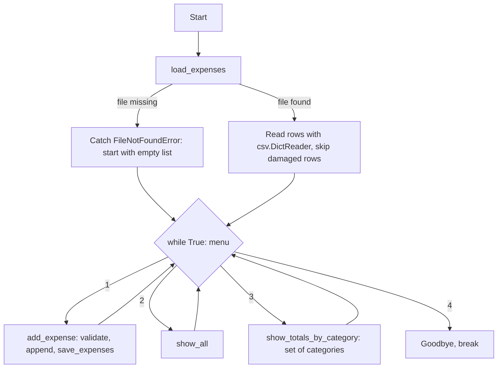

### 4.5 Function reference

| Function | Returns | Description |
|---|---|---|
| `load_expenses()` | `list` of dicts | Reads `expenses.csv`. Catches `FileNotFoundError` (start empty), unreadable files, and skips damaged rows with a warning. |
| `save_expenses(expenses)` | `bool` | Rewrites `expenses.csv` (header + one row per expense). Catches `OSError` and returns `False` if saving fails. |
| `unique_categories(expenses)` | `set` | A **set comprehension** of every category, each only once. |
| `get_valid_date()` | `str` | Loops until a valid `YYYY-MM-DD` date (or Enter for today); catches `ValueError` from `strptime`. |
| `get_valid_text(label)` | `str` | Loops until the text is not empty. |
| `get_valid_amount()` | `float` | Loops until the amount is a positive number; catches `ValueError` from `float()`. |
| `add_expense(expenses)` | `None` | Reads one expense, appends it and saves. |
| `short_text(text, width)` | `str` | Shortens long text with `...` for table alignment. |
| `show_all(expenses)` | `None` | Prints the table and total. |
| `show_totals_by_category(expenses)` | `None` | Prints the unique categories and a total per category. |
| `show_menu()`, `get_menu_choice()`, `main()` | | Menu display, menu validation and the main loop. |

### 4.6 Step by step

1. **Load.** `open(..., newline="", encoding="utf-8")` inside `with` opens the file, and `csv.DictReader` gives each row as a dictionary. Each row is converted (`float()` for the amount) inside its own `try/except`, so one bad row does not stop the others.
2. **Missing file.** `except FileNotFoundError` runs on the very first start, prints a message and returns an empty list.
3. **Add.** The new expense is a dictionary appended to the list, then `save_expenses()` rewrites the whole file with `csv.DictWriter`. The amount is written with 2 decimals.
4. **Unique categories.** `{expense["category"] for expense in expenses}` is a set comprehension: duplicates disappear automatically.
5. **Totals.** For each category in `sorted(categories)`, a list comprehension collects its amounts, and `sum()` and `len()` give the total and count.

---

## 5. Task 2: Attendance Log Cleaner

### 5.1 What it does
Reads `attendance.txt` (one name per line, with repeats, extra spaces and wrong capitals), cleans the names, counts the unique students and writes the sorted result to `attendance_clean.csv`.

### 5.2 Program flow

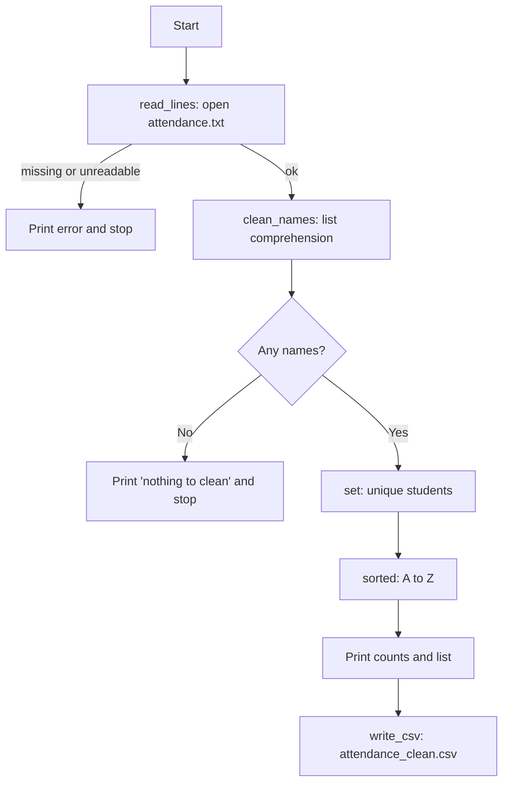

### 5.3 Function reference

| Function | Returns | Description |
|---|---|---|
| `read_lines(path)` | `list` or `None` | Reads the file with `readlines()`. Catches `FileNotFoundError`, `UnicodeDecodeError` and `OSError`, prints a message and returns `None`. |
| `clean_names(lines)` | `list` | One **list comprehension**: `[" ".join(line.strip().split()).title() for line in lines if line.strip()]`. |
| `write_csv(path, names)` | `bool` | Writes a `name` header and one row per student with `csv.writer`. Catches `OSError` (for example when the file is open in Excel). |
| `main()` | `None` | Reads, cleans, finds unique students with `set()`, sorts, prints and saves. |

### 5.4 Step by step

1. **Read.** `readlines()` gives every line, including the `\n` at the end.
2. **Clean (comprehension).** For each line that is not blank: `strip()` removes spaces at both ends, `split()` / `" ".join(...)` also collapses spaces *inside* a name (`"hina   malik"` becomes `"hina malik"`), and `title()` fixes the capitals.
3. **Unique (set).** `set(cleaned)` keeps one copy of each name. `len(cleaned) - len(unique)` is the number of duplicates removed.
4. **Sort and save.** `sorted(unique)` gives A to Z order; `csv.writer` writes the `name` header and the names.

### 5.5 Sample input and output

The included `attendance.txt` has 22 lines (19 names, 3 blank lines) with repeats, extra spaces and mixed capitals. See [section 7](#7-sample-run-data-saved-and-loaded-again) for the full run.

---

## 6. Errors Handled and Why

| Error | Where | Why it happens | What the program does |
|---|---|---|---|
| `FileNotFoundError` | `load_expenses()` | On the **first run** there is no `expenses.csv` yet. | Prints "No expenses.csv found" and starts with an empty list. The file is created by the first save. |
| `ValueError` | `get_valid_amount()` | `float()` fails when the user types text such as `abc`, `twenty` or `1,250`. | Shows a message and asks again. |
| `ValueError` | `get_valid_date()` | `strptime()` fails for the wrong format (`14-11-2026`) or an impossible date (`2026-13-45`). | Shows the correct format and asks again. |
| `ValueError`, `TypeError`, `KeyError` | `load_expenses()`, for each row | The CSV was edited by hand: amount is text, a column is missing, or a field is empty. | Skips only that row, counts the skipped rows, shows a warning, and loads the good rows. |
| `UnicodeDecodeError` | `load_expenses()`, `read_lines()` | The file was saved in another encoding, for example "Unicode" (UTF-16) from an editor. | Shows a clear message. The tracker starts empty; the cleaner stops without writing anything. |
| `OSError` (includes `PermissionError`) | `save_expenses()`, `write_csv()`, reading files | The file is locked because it is open in Excel, the folder is read-only, or the disk has a problem. | Shows a message. The tracker keeps the expense for the current session; nothing crashes. |
| `FileNotFoundError` | `read_lines()` | `attendance.txt` is missing, misspelled or in another folder. | Tells the user to put the file in the program's folder, then stops. |
| `KeyboardInterrupt`, `EOFError` | at the bottom of `expense_tracker.py` | The user presses Ctrl+C, or the input is closed. | Prints a polite message. Nothing is lost because each expense was already saved. |

Notes:
- The `with open(...)` statement closes the file even when an error happens, so no `finally` block is needed.
- The `OSError` cases depend on the operating system, so they are handled in the code but are **not** shown in the screenshots. Every other row above has a test in [section 9](#9-test-cases).

---

## 7. Sample Run: Data Saved and Loaded Again

### 7.1 Task 1: expense tracker, two runs

**Run 1** starts with no file, adds three expenses and quits. **Run 2** starts again: the three expenses are loaded from `expenses.csv`, a fourth is added, and the file now holds four rows.

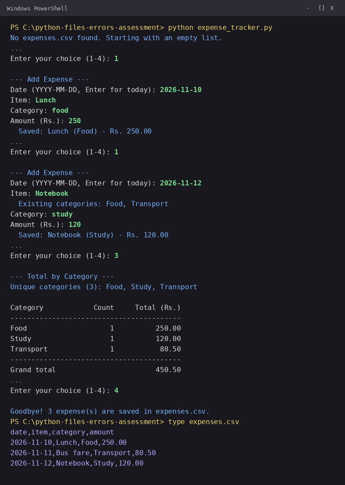

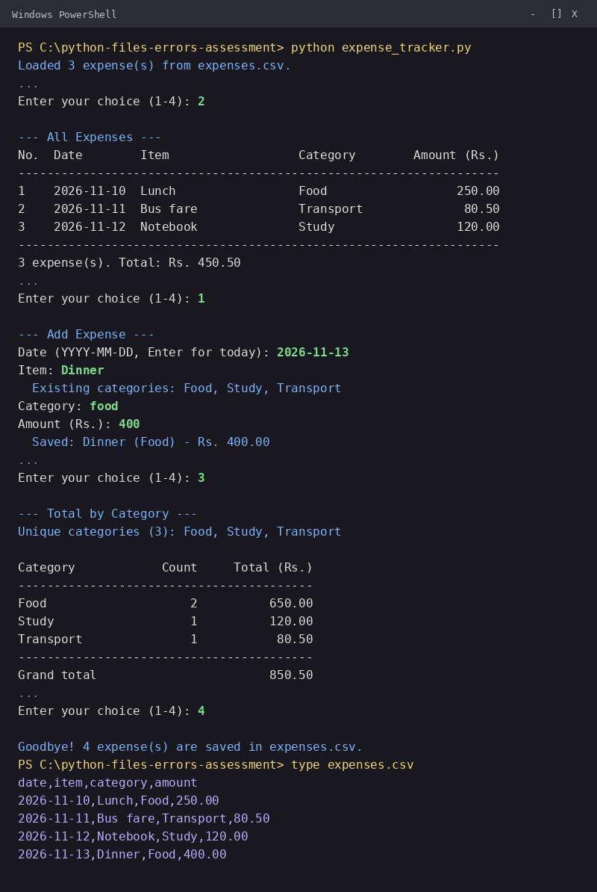

<details>
<summary><b>Click to expand the full terminal text of both runs</b></summary>

```text
# ---------- Run 1 ----------
PS C:\python-files-errors-assessment> python expense_tracker.py
No expenses.csv found. Starting with an empty list.

========================================
            EXPENSE TRACKER             
========================================
1. Add expense
2. Show all expenses
3. Total by category
4. Quit
----------------------------------------
Enter your choice (1-4): 1

--- Add Expense ---
Date (YYYY-MM-DD, Enter for today): 2026-11-10
Item: Lunch
Category: food
Amount (Rs.): 250
  Saved: Lunch (Food) - Rs. 250.00

========================================
            EXPENSE TRACKER             
========================================
1. Add expense
2. Show all expenses
3. Total by category
4. Quit
----------------------------------------
Enter your choice (1-4): 1

--- Add Expense ---
Date (YYYY-MM-DD, Enter for today): 2026-11-11
Item: Bus fare
  Existing categories: Food
Category: transport
Amount (Rs.): 80.5
  Saved: Bus fare (Transport) - Rs. 80.50

========================================
            EXPENSE TRACKER             
========================================
1. Add expense
2. Show all expenses
3. Total by category
4. Quit
----------------------------------------
Enter your choice (1-4): 1

--- Add Expense ---
Date (YYYY-MM-DD, Enter for today): 2026-11-12
Item: Notebook
  Existing categories: Food, Transport
Category: study
Amount (Rs.): 120
  Saved: Notebook (Study) - Rs. 120.00

========================================
            EXPENSE TRACKER             
========================================
1. Add expense
2. Show all expenses
3. Total by category
4. Quit
----------------------------------------
Enter your choice (1-4): 3

--- Total by Category ---
Unique categories (3): Food, Study, Transport

Category            Count     Total (Rs.)
-----------------------------------------
Food                    1          250.00
Study                   1          120.00
Transport               1           80.50
-----------------------------------------
Grand total                        450.50

========================================
            EXPENSE TRACKER             
========================================
1. Add expense
2. Show all expenses
3. Total by category
4. Quit
----------------------------------------
Enter your choice (1-4): 4

Goodbye! 3 expense(s) are saved in expenses.csv.

PS C:\python-files-errors-assessment> type expenses.csv
date,item,category,amount
2026-11-10,Lunch,Food,250.00
2026-11-11,Bus fare,Transport,80.50
2026-11-12,Notebook,Study,120.00

# ---------- Run 2 ----------
PS C:\python-files-errors-assessment> python expense_tracker.py
Loaded 3 expense(s) from expenses.csv.

========================================
            EXPENSE TRACKER             
========================================
1. Add expense
2. Show all expenses
3. Total by category
4. Quit
----------------------------------------
Enter your choice (1-4): 2

--- All Expenses ---
No.  Date        Item                  Category        Amount (Rs.)
-------------------------------------------------------------------
1    2026-11-10  Lunch                 Food                  250.00
2    2026-11-11  Bus fare              Transport              80.50
3    2026-11-12  Notebook              Study                 120.00
-------------------------------------------------------------------
3 expense(s). Total: Rs. 450.50

========================================
            EXPENSE TRACKER             
========================================
1. Add expense
2. Show all expenses
3. Total by category
4. Quit
----------------------------------------
Enter your choice (1-4): 1

--- Add Expense ---
Date (YYYY-MM-DD, Enter for today): 2026-11-13
Item: Dinner
  Existing categories: Food, Study, Transport
Category: food
Amount (Rs.): 400
  Saved: Dinner (Food) - Rs. 400.00

========================================
            EXPENSE TRACKER             
========================================
1. Add expense
2. Show all expenses
3. Total by category
4. Quit
----------------------------------------
Enter your choice (1-4): 3

--- Total by Category ---
Unique categories (3): Food, Study, Transport

Category            Count     Total (Rs.)
-----------------------------------------
Food                    2          650.00
Study                   1          120.00
Transport               1           80.50
-----------------------------------------
Grand total                        850.50

========================================
            EXPENSE TRACKER             
========================================
1. Add expense
2. Show all expenses
3. Total by category
4. Quit
----------------------------------------
Enter your choice (1-4): 4

Goodbye! 4 expense(s) are saved in expenses.csv.

PS C:\python-files-errors-assessment> type expenses.csv
date,item,category,amount
2026-11-10,Lunch,Food,250.00
2026-11-11,Bus fare,Transport,80.50
2026-11-12,Notebook,Study,120.00
2026-11-13,Dinner,Food,400.00
```

</details>

### 7.2 Task 2: attendance cleaner

`attendance.txt` before, the program run, and `attendance_clean.csv` after:


<details>
<summary><b>Click to expand the terminal text</b></summary>

```text
PS C:\python-files-errors-assessment> python attendance_cleaner.py
Names read (blank lines ignored) : 19
Unique students                  : 10
Duplicates removed               : 9

Unique students (sorted):
  1. Ali Raza
  2. Ayesha Siddiqui
  3. Bilal Ahmed
  4. Fatima Noor
  5. Hina Malik
  6. Maryam Aslam
  7. Omar Farooq
  8. Sara Khan
  9. Usman Ghani
  10. Zain Ul Abideen

Saved 10 name(s) to attendance_clean.csv

PS C:\python-files-errors-assessment> type attendance_clean.csv
name
Ali Raza
Ayesha Siddiqui
Bilal Ahmed
Fatima Noor
Hina Malik
Maryam Aslam
Omar Farooq
Sara Khan
Usman Ghani
Zain Ul Abideen
```

</details>

---

## 8. Python Concepts Used

| Concept | Where it is used |
|---|---|
| **Sets** | `set()` for unique students; set comprehension for unique categories; `sorted(set)` |
| **List comprehension** | `clean_names()` (with `if` filter); amounts per category |
| **Set comprehension** | `unique_categories()` |
| **Generator expression** | `sum(e["amount"] for e in expenses)` |
| **Files** | `open()` modes `"r"` (default) and `"w"`, `with`, `encoding="utf-8"`, `newline=""`, `readlines()` |
| **`csv` module** | `DictReader`, `DictWriter`, `writer`; automatic quoting of commas |
| **Exceptions** | `try / except` with `FileNotFoundError`, `ValueError`, `TypeError`, `KeyError`, `UnicodeDecodeError`, `OSError`, `KeyboardInterrupt`, `EOFError` |
| **`datetime`** | `date.today()`, `datetime.strptime()` to validate dates |
| **Lists of dictionaries** | Each expense is a dictionary in the `expenses` list |
| **String methods** | `strip()`, `title()`, `split()`, `join()` |
| **Loops and functions** | `while True` validation loops, `for` with `enumerate()`, small single-purpose functions |
| **f-strings** | `{x:,.2f}`, `{x:<22}`, `{x:>12}` |

---

## 9. Test Cases

All tests were run on **Windows (PowerShell)** against the final code, each in a fresh empty folder with only the files named in the test. Every expected result was checked automatically against the real program output and the real file contents. **Result: 38 of 38 passed.** In each screenshot, input you type is shown in **green**, errors in **red**, and file contents shown with `type` in **purple**. For long sessions a grey `...` marks where earlier lines were left out.

### 9.1 Summary

| ID | Program | Scenario | Status |
|---|---|---|---|
| [E-01](#e-01-first-run-no-file-yet-filenotfounderror) | Task 1 | First run: no file yet (`FileNotFoundError`) | ✅ Pass |
| [E-02](#e-02-add-an-expense-the-file-is-created) | Task 1 | Add an expense: the file is created | ✅ Pass |
| [E-03](#e-03-press-enter-to-use-todays-date) | Task 1 | Press Enter to use today's date | ✅ Pass |
| [E-04](#e-04-data-saved-then-loaded-again-two-runs) | Task 1 | Data saved, then loaded again (two runs) | ✅ Pass |
| [E-05](#e-05-new-expense-is-added-to-the-loaded-ones) | Task 1 | New expense is added to the loaded ones | ✅ Pass |
| [E-06](#e-06-show-all-expenses) | Task 1 | Show all expenses | ✅ Pass |
| [E-07](#e-07-show-all-when-there-are-no-expenses) | Task 1 | Show all when there are no expenses | ✅ Pass |
| [E-08](#e-08-total-by-category-and-the-set-of-unique-categories) | Task 1 | Total by category and the set of unique categories | ✅ Pass |
| [E-09](#e-09-total-by-category-when-empty) | Task 1 | Total by category when empty | ✅ Pass |
| [E-10](#e-10-amount-is-not-a-number-valueerror-caught) | Task 1 | Amount is not a number (`ValueError` caught) | ✅ Pass |
| [E-11](#e-11-amount-zero-negative-inf-or-nan) | Task 1 | Amount zero, negative, `inf` or `nan` | ✅ Pass |
| [E-12](#e-12-invalid-dates-valueerror-caught) | Task 1 | Invalid dates (`ValueError` caught) | ✅ Pass |
| [E-13](#e-13-empty-item-or-category) | Task 1 | Empty item or category | ✅ Pass |
| [E-14](#e-14-category-cleaning-groups---food--and-food-together) | Task 1 | Category cleaning groups `  fOOD ` and `food` together | ✅ Pass |
| [E-15](#e-15-comma-inside-an-item-csv-quoting-saved-and-reloaded) | Task 1 | Comma inside an item (CSV quoting), saved and reloaded | ✅ Pass |
| [E-16](#e-16-invalid-menu-choices) | Task 1 | Invalid menu choices | ✅ Pass |
| [E-17](#e-17-menu-choice-with-extra-spaces) | Task 1 | Menu choice with extra spaces | ✅ Pass |
| [E-18](#e-18-damaged-rows-in-the-file-are-skipped) | Task 1 | Damaged rows in the file are skipped | ✅ Pass |
| [E-19](#e-19-empty-file-0-bytes) | Task 1 | Empty file (0 bytes) | ✅ Pass |
| [E-20](#e-20-file-with-only-the-header-row) | Task 1 | File with only the header row | ✅ Pass |
| [E-21](#e-21-existing-categories-shown-while-adding) | Task 1 | Existing categories shown while adding | ✅ Pass |
| [E-22](#e-22-long-item-is-shortened-in-the-table) | Task 1 | Long item is shortened in the table | ✅ Pass |
| [E-23](#e-23-quit-message-when-expenses-exist) | Task 1 | Quit message when expenses exist | ✅ Pass |
| [E-24](#e-24-decimal-amounts-and-thousands-separator) | Task 1 | Decimal amounts and thousands separator | ✅ Pass |
| [E-25](#e-25-unreadable-file-unicodedecodeerror-caught) | Task 1 | Unreadable file (`UnicodeDecodeError` caught) | ✅ Pass |
| [A-01](#a-01-the-sample-attendancetxt) | Task 2 | The sample `attendance.txt` | ✅ Pass |
| [A-02](#a-02-extra-spaces-and-capitals) | Task 2 | Extra spaces and capitals | ✅ Pass |
| [A-03](#a-03-blank-and-whitespaceonly-lines-are-ignored) | Task 2 | Blank and whitespace-only lines are ignored | ✅ Pass |
| [A-04](#a-04-output-is-sorted-a-to-z) | Task 2 | Output is sorted A to Z | ✅ Pass |
| [A-05](#a-05-attendancetxt-is-missing-filenotfounderror-caught) | Task 2 | `attendance.txt` is missing (`FileNotFoundError` caught) | ✅ Pass |
| [A-06](#a-06-empty-attendancetxt) | Task 2 | Empty `attendance.txt` | ✅ Pass |
| [A-07](#a-07-file-with-only-blank-lines) | Task 2 | File with only blank lines | ✅ Pass |
| [A-08](#a-08-no-duplicates) | Task 2 | No duplicates | ✅ Pass |
| [A-09](#a-09-the-same-student-five-times) | Task 2 | The same student five times | ✅ Pass |
| [A-10](#a-10-an-old-csv-is-overwritten) | Task 2 | An old CSV is overwritten | ✅ Pass |
| [A-11](#a-11-not-utf8-text-unicodedecodeerror-caught) | Task 2 | Not UTF-8 text (`UnicodeDecodeError` caught) | ✅ Pass |
| [A-12](#a-12-windows-line-endings-crlf) | Task 2 | Windows line endings (CRLF) | ✅ Pass |
| [A-13](#a-13-how-title-handles-special-names) | Task 2 | How `.title()` handles special names | ✅ Pass |

### 9.2 Task 1: `expense_tracker.py`

#### E-01: First run: no file yet (`FileNotFoundError`)

| | |
|---|---|
| **Input** | Start with no `expenses.csv`, choose `4` |
| **Expected** | Message that the file is missing, program starts empty and does not crash; no file is created |
| **Actual** | Matches expected |
| **Status** | ✅ Pass |

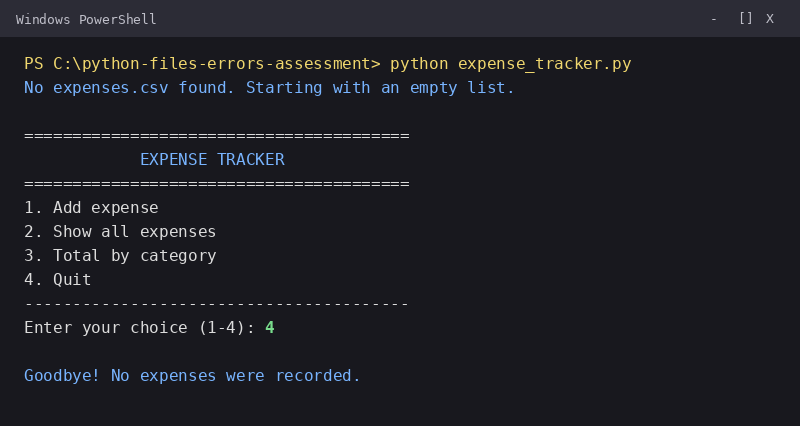


#### E-02: Add an expense: the file is created

| | |
|---|---|
| **Input** | Date `2026-11-10`, item `Lunch`, category `food`, amount `250` |
| **Expected** | Saved message; `expenses.csv` created with header and one row (category in Title Case) |
| **Actual** | Matches expected |
| **Status** | ✅ Pass |

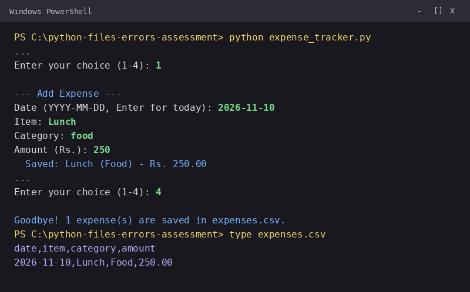


#### E-03: Press Enter to use today's date

| | |
|---|---|
| **Input** | Date left empty, item `Tea`, category `drinks`, amount `60` |
| **Expected** | Today's date is saved |
| **Actual** | Matches expected |
| **Status** | ✅ Pass |

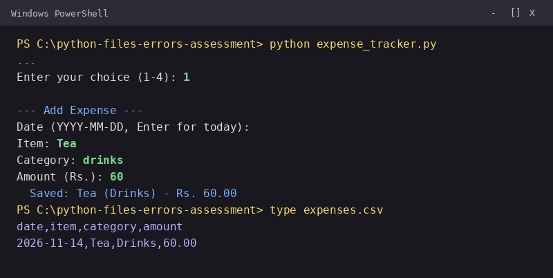


#### E-04: Data saved, then loaded again (two runs)

| | |
|---|---|
| **Input** | Run 1: add Lunch `250` and Bus fare `80.5`, quit. Run 2: start again and choose `2` |
| **Expected** | Run 1 starts empty; Run 2 loads both expenses from the file and shows them |
| **Actual** | Matches expected |
| **Status** | ✅ Pass |

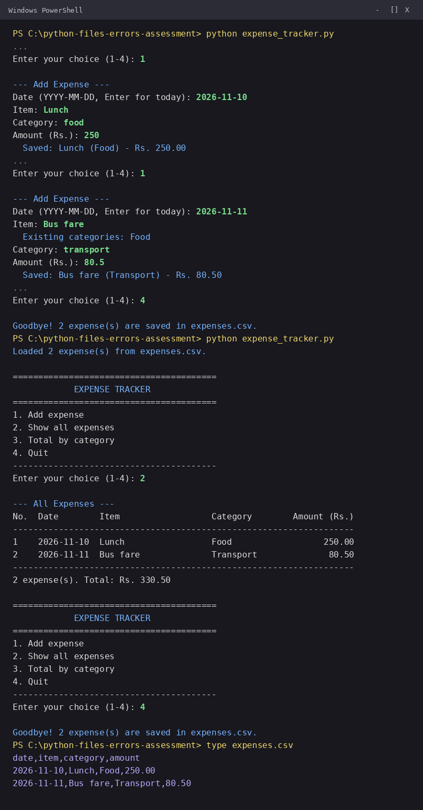


#### E-05: New expense is added to the loaded ones

| | |
|---|---|
| **Input** | File already holds 3 expenses; add Juice `90` |
| **Expected** | File now has 4 rows; the old rows are unchanged |
| **Actual** | Matches expected |
| **Status** | ✅ Pass |

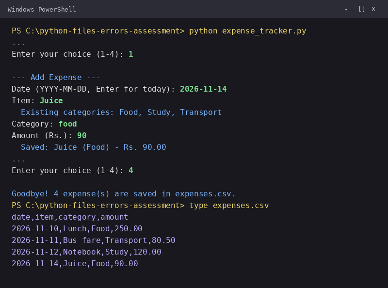


#### E-06: Show all expenses

| | |
|---|---|
| **Input** | File holds 3 expenses; choose `2` |
| **Expected** | Numbered table and total 450.50 |
| **Actual** | Matches expected |
| **Status** | ✅ Pass |

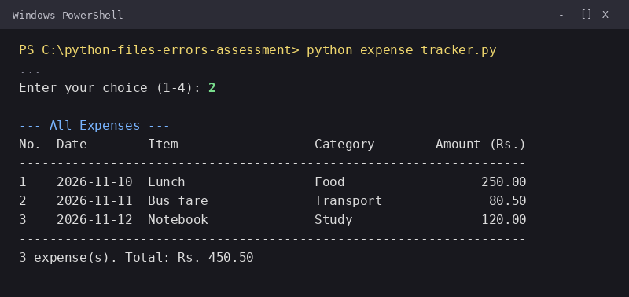


#### E-07: Show all when there are no expenses

| | |
|---|---|
| **Input** | No file, choose `2` |
| **Expected** | Friendly message |
| **Actual** | Matches expected |
| **Status** | ✅ Pass |


#### E-08: Total by category and the set of unique categories

| | |
|---|---|
| **Input** | File holds 5 expenses in 3 categories; choose `3` |
| **Expected** | The unique categories (a set) are listed, then a total for each and a grand total |
| **Actual** | Matches expected |
| **Status** | ✅ Pass |

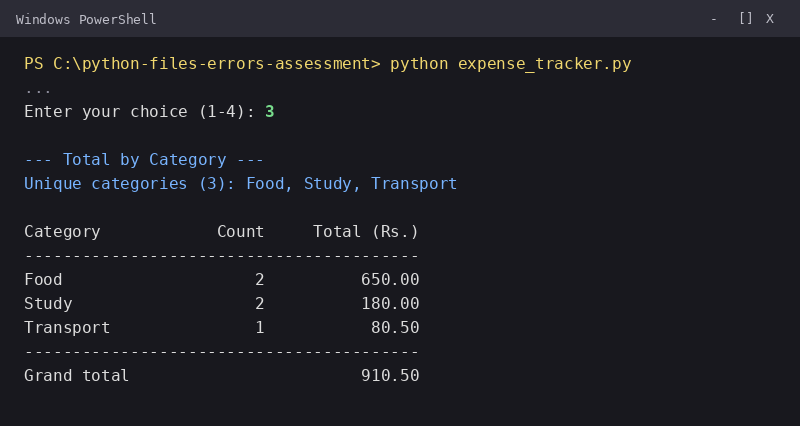


#### E-09: Total by category when empty

| | |
|---|---|
| **Input** | No file, choose `3` |
| **Expected** | Friendly message |
| **Actual** | Matches expected |
| **Status** | ✅ Pass |

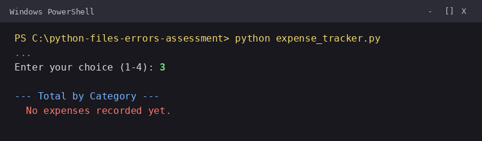


#### E-10: Amount is not a number (`ValueError` caught)

| | |
|---|---|
| **Input** | Amount `abc`, `twenty`, empty, `1,250`, then `250` |
| **Expected** | Four bad values are caught and asked again; `250` is saved |
| **Actual** | Matches expected |
| **Status** | ✅ Pass |

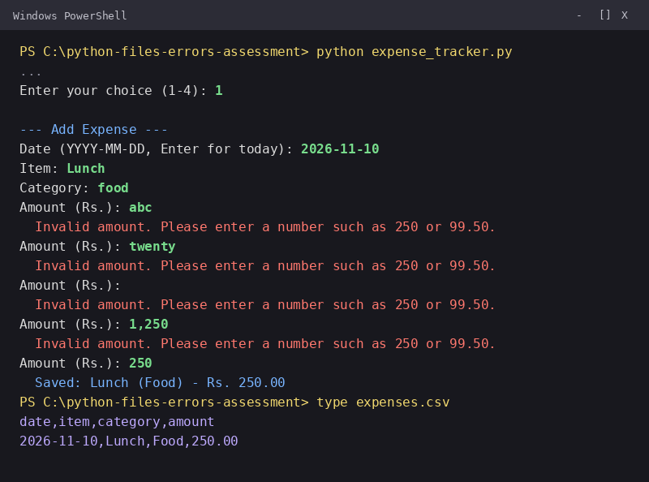


#### E-11: Amount zero, negative, `inf` or `nan`

| | |
|---|---|
| **Input** | Amount `0`, `-50`, `inf`, `nan`, then `100` |
| **Expected** | `0` and `-50` rejected as not above zero; `inf` and `nan` rejected as non-numbers |
| **Actual** | Matches expected |
| **Status** | ✅ Pass |

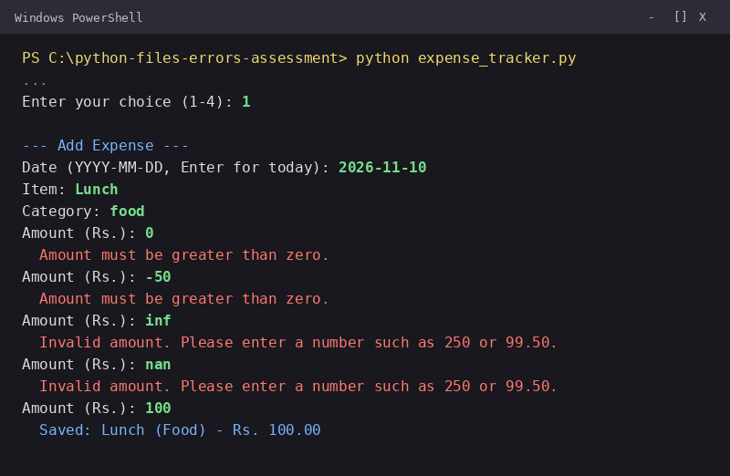


#### E-12: Invalid dates (`ValueError` caught)

| | |
|---|---|
| **Input** | Date `14-11-2026`, `2026-13-45`, `yesterday`, then `2026-1-5` |
| **Expected** | Three bad dates rejected; `2026-1-5` accepted and saved as `2026-01-05` |
| **Actual** | Matches expected |
| **Status** | ✅ Pass |

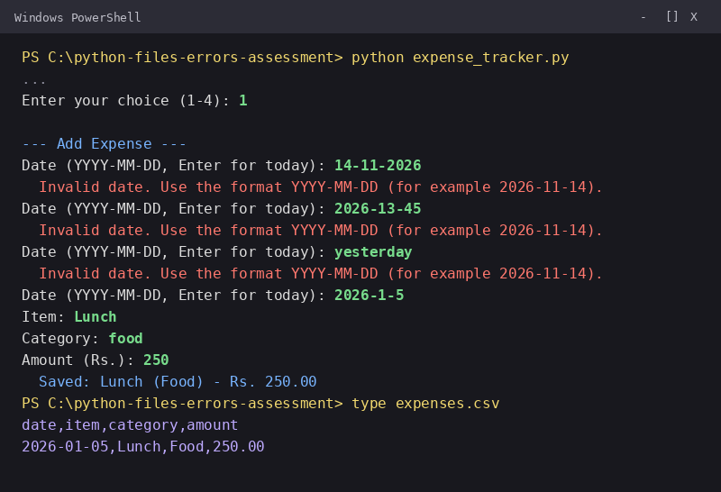


#### E-13: Empty item or category

| | |
|---|---|
| **Input** | Item `   `, then `Lunch`; category `  `, then `food` |
| **Expected** | Both empty values rejected |
| **Actual** | Matches expected |
| **Status** | ✅ Pass |

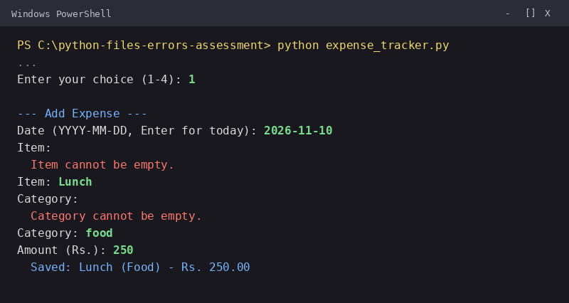


#### E-14: Category cleaning groups `  fOOD ` and `food` together

| | |
|---|---|
| **Input** | Two expenses with categories `  fOOD ` and `food` |
| **Expected** | One category, `Food`, with count 2 and total 300.00 |
| **Actual** | Matches expected |
| **Status** | ✅ Pass |

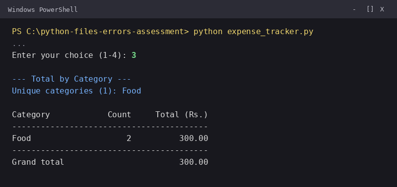


#### E-15: Comma inside an item (CSV quoting), saved and reloaded

| | |
|---|---|
| **Input** | Run 1: item `Tea, milk and sugar`. Run 2: show all |
| **Expected** | The csv module quotes the item, and it is read back correctly |
| **Actual** | Matches expected |
| **Status** | ✅ Pass |

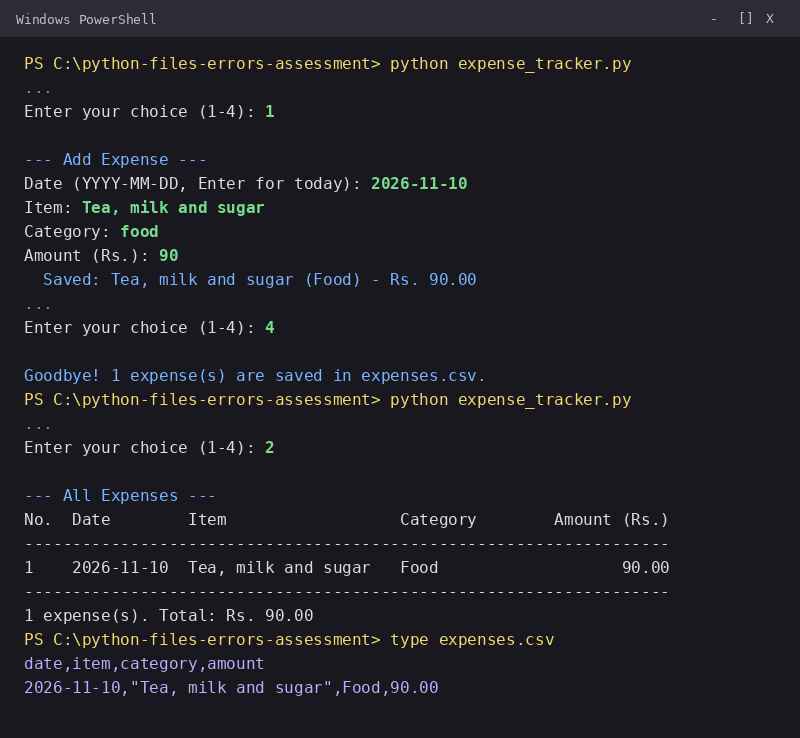


#### E-16: Invalid menu choices

| | |
|---|---|
| **Input** | `0`, `5`, `abc`, empty, `2.5`, then `4` |
| **Expected** | All five rejected; `4` quits |
| **Actual** | Matches expected |
| **Status** | ✅ Pass |

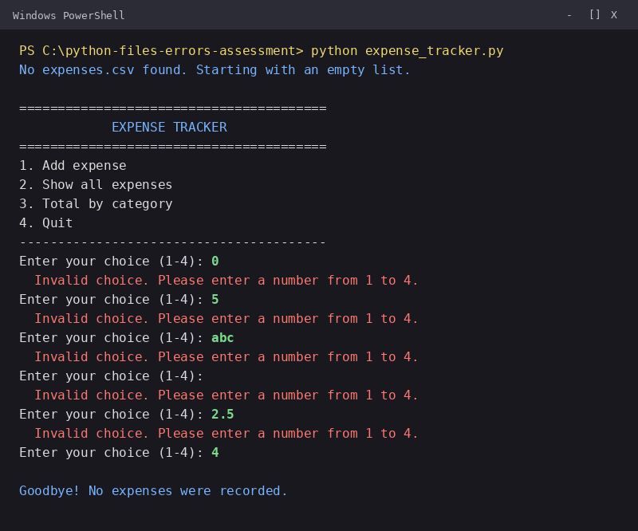


#### E-17: Menu choice with extra spaces

| | |
|---|---|
| **Input** | Menu choice ` 2 ` |
| **Expected** | Trimmed and accepted as `2` |
| **Actual** | Matches expected |
| **Status** | ✅ Pass |

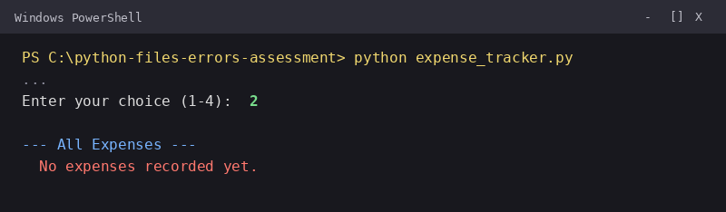


#### E-18: Damaged rows in the file are skipped

| | |
|---|---|
| **Input** | File has 5 data rows: one with amount `abc`, one with a missing amount, one with an empty item |
| **Expected** | Only the 2 good rows are loaded; a warning says 3 rows were skipped |
| **Actual** | Matches expected |
| **Status** | ✅ Pass |

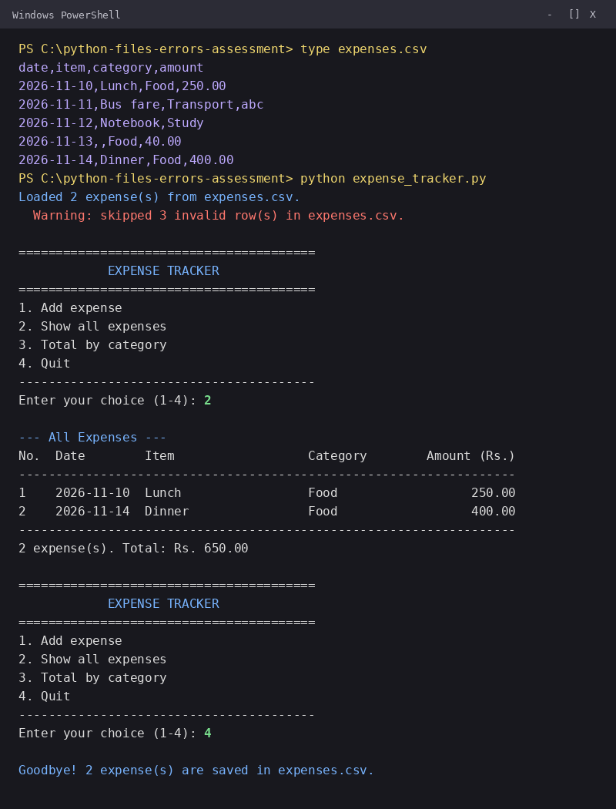


#### E-19: Empty file (0 bytes)

| | |
|---|---|
| **Input** | `expenses.csv` exists but is empty; add Lunch |
| **Expected** | Loads 0 expenses without crashing; the header is written when saving |
| **Actual** | Matches expected |
| **Status** | ✅ Pass |

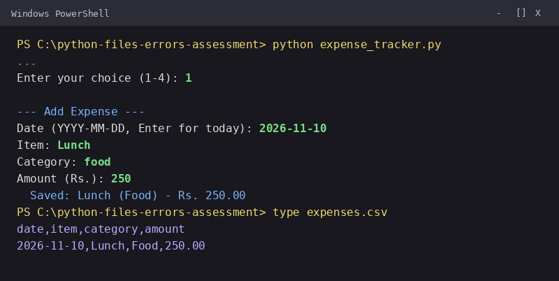


#### E-20: File with only the header row

| | |
|---|---|
| **Input** | `expenses.csv` contains only the header |
| **Expected** | Loads 0 expenses; list is empty |
| **Actual** | Matches expected |
| **Status** | ✅ Pass |


#### E-21: Existing categories shown while adding

| | |
|---|---|
| **Input** | File holds Food, Transport and Study; add a new expense |
| **Expected** | The unique categories (a set) are listed before the category prompt |
| **Actual** | Matches expected |
| **Status** | ✅ Pass |

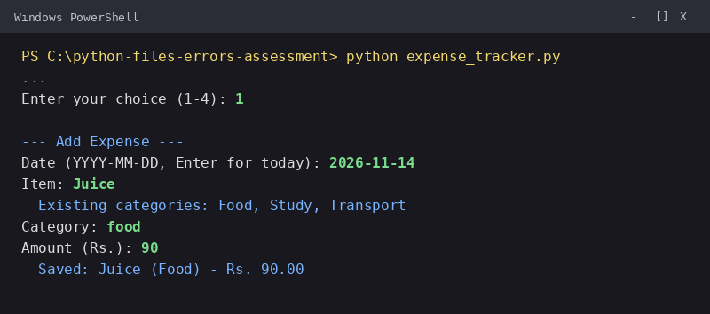


#### E-22: Long item is shortened in the table

| | |
|---|---|
| **Input** | Item of 38 characters |
| **Expected** | Shown as `Monthly electrici...`; the full text is still saved |
| **Actual** | Matches expected |
| **Status** | ✅ Pass |

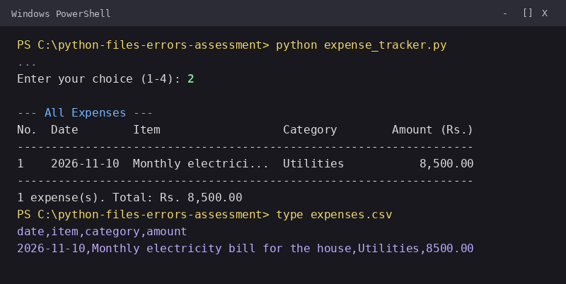


#### E-23: Quit message when expenses exist

| | |
|---|---|
| **Input** | File holds 3 expenses; choose `4` |
| **Expected** | Goodbye message states how many are saved |
| **Actual** | Matches expected |
| **Status** | ✅ Pass |

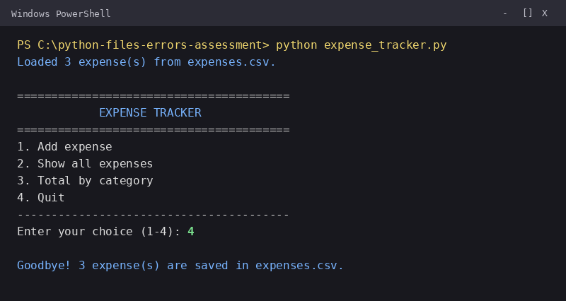


#### E-24: Decimal amounts and thousands separator

| | |
|---|---|
| **Input** | Laptop bag `1250.5`, Phone case `99.5` |
| **Expected** | Amounts shown as 1,250.50 and 99.50; total 1,350.00 |
| **Actual** | Matches expected |
| **Status** | ✅ Pass |

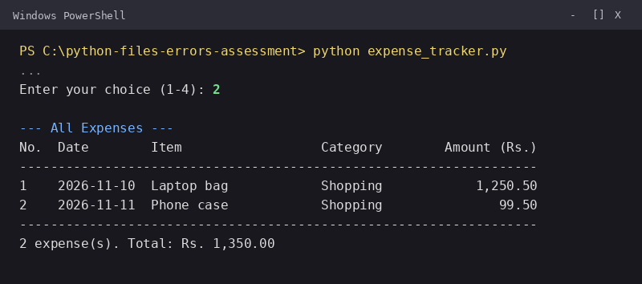


#### E-25: Unreadable file (`UnicodeDecodeError` caught)

| | |
|---|---|
| **Input** | `expenses.csv` is a UTF-16 file (saved as `Unicode` in an editor) |
| **Expected** | A clear message; the program starts empty instead of crashing |
| **Actual** | Matches expected |
| **Status** | ✅ Pass |

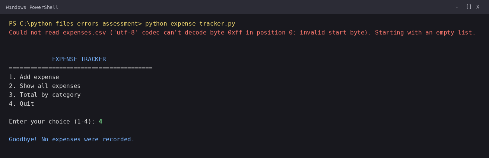


### 9.3 Task 2: `attendance_cleaner.py`

#### A-01: The sample `attendance.txt`

| | |
|---|---|
| **Input** | The included `attendance.txt` (22 lines: repeats, extra spaces, mixed capitals, blank lines) |
| **Expected** | 19 names read, 10 unique students, 9 duplicates removed; sorted list saved to the CSV |
| **Actual** | Matches expected |
| **Status** | ✅ Pass |

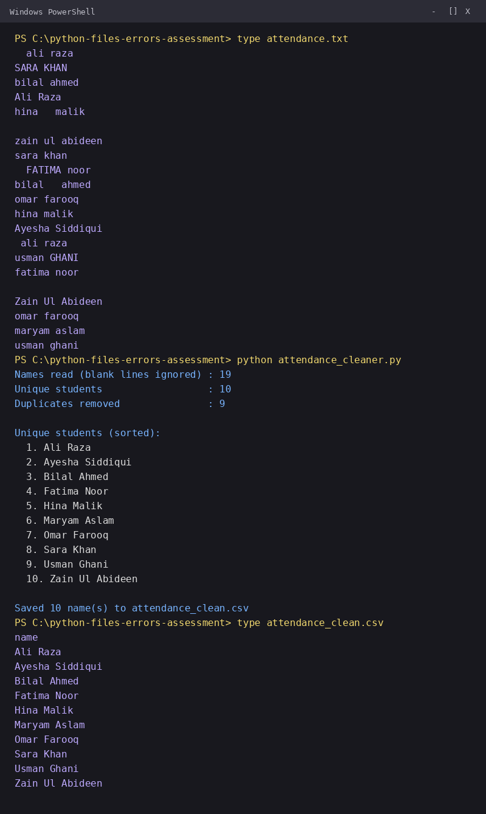


#### A-02: Extra spaces and capitals

| | |
|---|---|
| **Input** | `  ALI RAZA  `, `ali raza`, `Ali   Raza` |
| **Expected** | All three become `Ali Raza`: 3 read, 1 unique, 2 duplicates |
| **Actual** | Matches expected |
| **Status** | ✅ Pass |

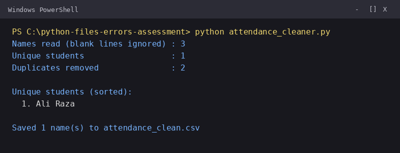


#### A-03: Blank and whitespace-only lines are ignored

| | |
|---|---|
| **Input** | Two names with empty and whitespace-only lines between them |
| **Expected** | 2 names read, 2 unique |
| **Actual** | Matches expected |
| **Status** | ✅ Pass |

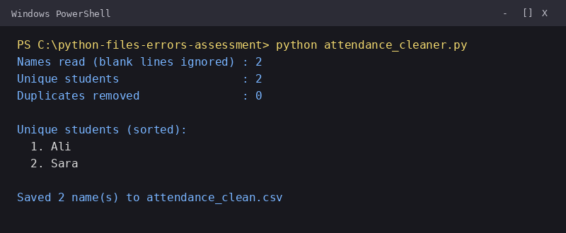


#### A-04: Output is sorted A to Z

| | |
|---|---|
| **Input** | `zain`, `ali`, `maryam`, `bilal` |
| **Expected** | CSV lists Ali, Bilal, Maryam, Zain |
| **Actual** | Matches expected |
| **Status** | ✅ Pass |

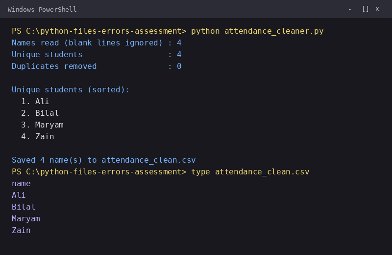


#### A-05: `attendance.txt` is missing (`FileNotFoundError` caught)

| | |
|---|---|
| **Input** | No `attendance.txt` in the folder |
| **Expected** | Clear error message; no CSV is created |
| **Actual** | Matches expected |
| **Status** | ✅ Pass |

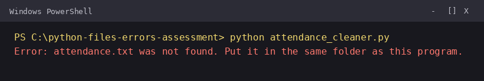


#### A-06: Empty `attendance.txt`

| | |
|---|---|
| **Input** | An empty file |
| **Expected** | Message that there is nothing to clean; no CSV is created |
| **Actual** | Matches expected |
| **Status** | ✅ Pass |


#### A-07: File with only blank lines

| | |
|---|---|
| **Input** | Only blank and whitespace-only lines |
| **Expected** | Same message; no CSV is created |
| **Actual** | Matches expected |
| **Status** | ✅ Pass |

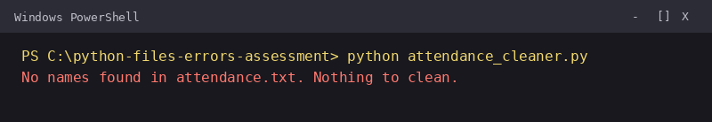


#### A-08: No duplicates

| | |
|---|---|
| **Input** | Three different names |
| **Expected** | 3 read, 3 unique, 0 duplicates |
| **Actual** | Matches expected |
| **Status** | ✅ Pass |

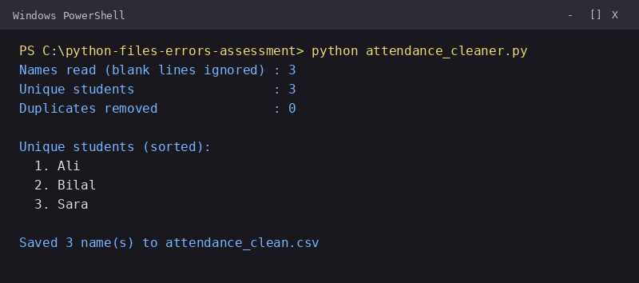


#### A-09: The same student five times

| | |
|---|---|
| **Input** | `ali`, `ALI`, ` Ali`, `ali `, `Ali` |
| **Expected** | 5 read, 1 unique, 4 duplicates |
| **Actual** | Matches expected |
| **Status** | ✅ Pass |

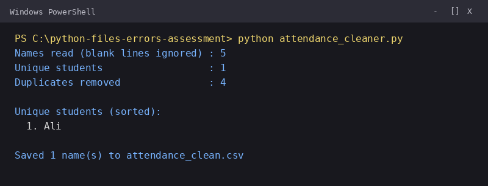


#### A-10: An old CSV is overwritten

| | |
|---|---|
| **Input** | `attendance_clean.csv` already holds `Old Name` |
| **Expected** | The file is replaced with the new cleaned list |
| **Actual** | Matches expected |
| **Status** | ✅ Pass |

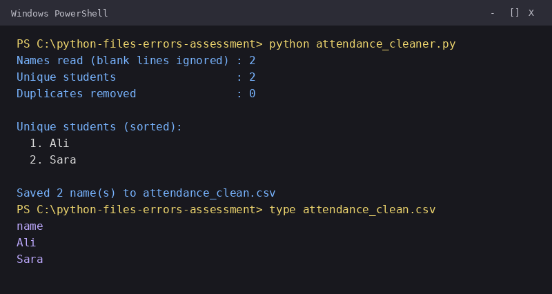


#### A-11: Not UTF-8 text (`UnicodeDecodeError` caught)

| | |
|---|---|
| **Input** | `attendance.txt` saved as UTF-16 (`Unicode` in an editor) |
| **Expected** | Clear error message; no CSV is created |
| **Actual** | Matches expected |
| **Status** | ✅ Pass |

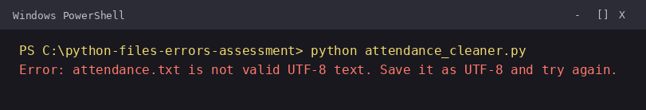


#### A-12: Windows line endings (CRLF)

| | |
|---|---|
| **Input** | A file saved with Windows line endings |
| **Expected** | Read correctly: 3 read, 2 unique |
| **Actual** | Matches expected |
| **Status** | ✅ Pass |


#### A-13: How `.title()` handles special names

| | |
|---|---|
| **Input** | `o'brien`, `anne-marie`, `mcdonald` |
| **Expected** | `O'Brien` and `Anne-Marie` are right; `Mcdonald` is a known limit of `.title()` |
| **Actual** | Matches expected |
| **Status** | ✅ Pass |

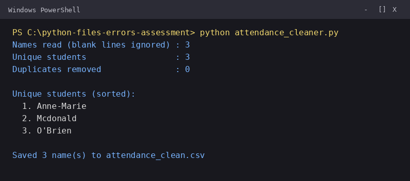


### 9.4 How to reproduce a test on Windows

Open PowerShell in an **empty test folder** that contains a copy of the program (and any file the test needs) and run it:

```powershell
python expense_tracker.py
```

To feed the inputs automatically, pipe them. In PowerShell `` `n `` means "press Enter":

```powershell
# E-02: add one expense, then quit
"1`n2026-11-10`nLunch`nfood`n250`n4" | python expense_tracker.py
type expenses.csv
```

In **Command Prompt (cmd)**, put `&` directly after each value (no spaces):

```bat
(echo 1&echo 2026-11-10&echo Lunch&echo food&echo 250&echo 4) | python expense_tracker.py
```

Delete `expenses.csv` between tests that start with "no file".

---

## 10. Design Decisions

| Decision | Reason |
|---|---|
| **Save after every add** | The program may be closed at any moment; saving each time means nothing is lost. |
| **Rewrite the whole file on each save** | Simple and always consistent, and fine for a small personal tracker. |
| **Use the `csv` module, not `split(",")`** | It handles commas and quotes inside an item (test E-15), which manual splitting would break. |
| **`newline=""` when opening CSV files** | Recommended by Python's `csv` documentation; it prevents blank lines between rows on Windows. |
| **`encoding="utf-8"` everywhere** | Windows may otherwise use another default encoding, and names would be read differently on different computers. |
| **Skip damaged rows with a warning** | One bad row should not stop the whole file from loading, and the user is told how many were skipped. |
| **Amount stored with 2 decimals** | Money looks the same every time it is loaded. |
| **Category in Title Case** | `food`, `Food` and ` FOOD ` become one category, which also keeps the set of unique categories clean. |
| **Unique categories shown while adding** | Helps the user reuse an existing category instead of inventing a near-duplicate. |
| **`" ".join(line.strip().split())` in the cleaner** | `strip()` only trims the ends; this also fixes spaces inside a name, so `hina   malik` and `hina malik` count as one student. |
| **Cleaner writes nothing when there are no names** | Avoids replacing a good CSV with an empty one. |
| **`sorted(set)` before writing** | A set has no order; sorting makes the output predictable (test A-04). |

---

## 11. Known Limitations & Future Improvements

**Current limitations**
- If `expenses.csv` contains damaged rows, they are skipped when loading and are **not written back** the next time you add an expense. Fix such rows in a text editor first.
- There is no way to edit or delete an expense inside the program.
- `.title()` is simple: `mcdonald` becomes `Mcdonald` (test A-13).
- Two different students with exactly the same name are counted as one.
- The cleaner reads UTF-8 text only; a file saved as UTF-16 gives an error message (test A-11).
- The `OSError` situations (locked or read-only file) are handled in the code but not demonstrated in the screenshots.

**Possible improvements**
- Add "edit" and "delete" options to the tracker.
- Filter expenses by month, and show totals per month.
- Let the cleaner accept the input file name as a command-line argument (`sys.argv`).
- Show how many times each student appears (`collections.Counter`).
- Add automated tests with `unittest` or `pytest`, reusing the cases in section 9.

---

*Built for the "Sets, Files, Errors and CSV" assessment.*
