# Smart Grocery Store Management System

> A menu-driven Python application that helps a local grocery store manage products, stock, customer sales and reports, using **lists of dictionaries** as its main data structures.


---

## Table of Contents

1. [Overview](#1-overview)
2. [Features (Menu Options)](#2-features-menu-options)
3. [Data Structures](#3-data-structures)
4. [Repository Structure](#4-repository-structure)
5. [Getting Started (Windows)](#5-getting-started-windows)
6. [How It Works](#6-how-it-works)
7. [Sample Run](#7-sample-run)
8. [Python Concepts Used](#8-python-concepts-used)
9. [Test Cases](#9-test-cases)
10. [Design Decisions](#10-design-decisions)
11. [Known Limitations & Future Improvements](#11-known-limitations--future-improvements)

---

## 1. Overview

The store owner needs to keep records of products, prices, stock and sales. This program stores each product as a dictionary inside a list, records each completed sale as a dictionary inside a second list, and lets the owner manage everything from a menu that keeps running until they choose to exit.

Engineering principles used:

- **Lists of dictionaries** hold all data; values are read and changed through dictionary keys such as `product["stock"]`.
- **The app does not crash on wrong input.** Every input is validated and asked again, or a clear message is shown.
- **Small functions.** Each menu option has its own function, and shared helpers handle input checking and lookups.
- **Safe sales.** A sale is refused when the product does not exist, is out of stock, or the quantity is more than the stock.
- **Importable.** The file uses `if __name__ == "__main__":`.

Only the standard library (`math`) is used.

---

## 2. Features (Menu Options)

```text
====================================
SMART GROCERY STORE SYSTEM
====================================

1. Add New Product
2. View All Products
3. Search Product
4. Update Product Stock
5. Process Customer Sale
6. View Sales Records
7. Generate Store Report
8. Exit

Enter your choice:
```

| Option | Feature | What it does |
|---|---|---|
| **1** | Add New Product | Reads ID, name, category, price and stock; blocks duplicate IDs; appends a dictionary with `.append()`. |
| **2** | View All Products | Prints an aligned table of all products. Products with stock below 5 are marked `LOW`. |
| **3** | Search Product | Finds products by ID (digits) or by name (case-insensitive, partial match) and shows complete details. |
| **4** | Update Product Stock | Asks for a product ID, then either adds units to the current stock or sets a new quantity. Shows old and new stock. |
| **5** | Process Customer Sale | Checks the product and stock, calculates the total, deducts the stock, records the sale and prints a purchase summary. |
| **6** | View Sales Records | Lists every completed sale with the total revenue. |
| **7** | Generate Store Report | Total products, total stock, number of sales, revenue, low-stock products, highest and lowest priced products. |
| **8** | Exit | Leaves the loop with `break` and prints a goodbye message. |

**Input rules**

| Input | Accepted values |
|---|---|
| Menu choice | `1` to `8` (extra spaces are ignored) |
| Product ID | Whole number, 1 or more, not already used |
| Name, Category | Not empty |
| Price | A number greater than 0 (text, `0`, negatives, `nan` and `inf` are rejected) |
| Stock when adding a product, or a new quantity | Whole number, 0 or more |
| Units to add, purchase quantity | Whole number, 1 or more |

---

## 3. Data Structures

**Products** are a list of dictionaries:

```python
products = [
    {"id": 101, "name": "Milk",   "category": "Dairy",  "price": 250,  "stock": 20},
    {"id": 103, "name": "Rice",   "category": "Grains", "price": 1200, "stock": 8},
]
```

**Sales records** are a separate list of dictionaries, one per completed sale:

```python
sales = [
    {"product_id": 101, "product_name": "Milk", "quantity_sold": 3, "total_amount": 750.0},
]
```

The program starts with six sample products (Milk, Eggs, Rice, Apples, Sugar, Bread) so it can be used immediately; two of them have stock below 5 to show the low-stock features.

---

## 4. Repository Structure

```text
smart-grocery-store-system/
│
├── grocery_store_system.py   # The application
├── README.md                 # Documentation (this file)
└── images/                   # Windows terminal screenshots (sample runs + one per test case)
    └── tests/                # One screenshot for each of the 40 test cases
```

---

## 5. Getting Started (Windows)

### Prerequisites
- Windows 10 or 11
- Python 3.8 or newer from [python.org](https://www.python.org/downloads/). During installation, **tick "Add python.exe to PATH"**.
- Check the installation in PowerShell or Command Prompt:

```powershell
python --version
```

If `python` is not recognised, try `py --version` and use `py` instead of `python` below.

### Run
1. Open the project folder in File Explorer.
2. Click the address bar, type `powershell` and press **Enter**. (In VS Code, use **Terminal > New Terminal**.)
3. Start the app:

```powershell
python grocery_store_system.py
```

4. Type a number from 1 to 8 and press **Enter**. Choose **8** to exit.

All screenshots in this README were taken in Windows PowerShell.

---

## 6. How It Works

### 6.1 Program flow

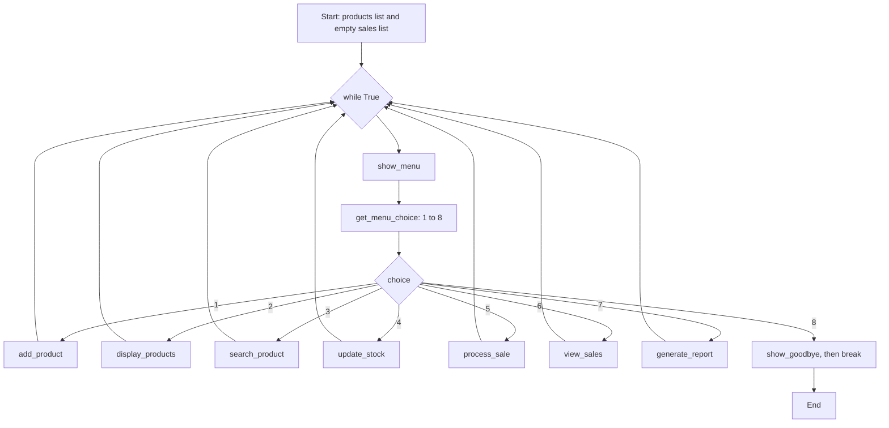

### 6.2 Function reference

| Function | Parameters | Returns | Description |
|---|---|---|---|
| `get_menu_choice()` | none | `int` | Loops until the user enters 1 to 8. |
| `get_valid_text(prompt)` | `prompt: str` | `str` | Loops until the text is not empty. |
| `get_valid_int(prompt, minimum)` | `prompt: str`, `minimum: int` | `int` | Loops until a whole number at least `minimum` is entered. |
| `get_valid_price(prompt)` | `prompt: str` | `float` | Loops until a number greater than 0 is entered. |
| `find_product_by_id(products, product_id)` | list, `int` | `dict` or `None` | Loops through the products and returns the matching dictionary. |
| `find_products_by_name(products, search_text)` | list, `str` | `list` | Returns every product whose name contains the text, ignoring capitals. |
| `short_text(text, width)` | `str`, `int` | `str` | Shortens long text with `...` for table alignment. |
| `print_product_details(product)` | `dict` | `None` | Prints all details of one product. |
| `show_menu()` | none | `None` | Prints the main menu. |
| `add_product(products)` | list | `None` | Reads a product, blocks duplicate IDs and appends the dictionary. |
| `display_products(products)` | list | `None` | Prints the product table. |
| `search_product(products)` | list | `None` | Searches by ID or name and prints the details. |
| `update_stock(products)` | list | `None` | Adds stock to, or sets the quantity of, one product. |
| `process_sale(products, sales)` | two lists | `None` | Validates and completes a sale; records it in `sales`. |
| `view_sales(sales)` | list | `None` | Prints the sales table and total revenue. |
| `generate_report(products, sales)` | two lists | `None` | Prints the store report. |
| `show_goodbye(sales)` | list | `None` | Prints the goodbye message. |
| `main()` | none | `None` | Holds the data and the `while True` menu loop. |

**Constant:** `LOW_STOCK_LIMIT = 5`.

### 6.3 Step by step

1. **Menu loop.** `main()` creates the `products` and `sales` lists, then runs `while True`. Each pass shows the menu, reads a choice and calls the matching function with an `if / elif / else` chain.
2. **Validated input.** Each `get_valid_...` function wraps `input()` in its own `while True` loop and only `return`s a good value. `int()` and `float()` raise `ValueError` for text, which is caught with `try/except`. `float()` also accepts `nan` and `inf`, so `math.isfinite()` rejects them.
3. **Add a product.** A loop asks for the ID until `find_product_by_id()` returns `None`, which blocks duplicates. The values are packed into a dictionary and added with `products.append(product)`.
4. **View.** A `for` loop goes through `products` and prints one formatted row each, reading values with keys such as `product["price"]`. A conditional adds the `LOW` flag when `product["stock"] < 5`.
5. **Search.** If the text is all digits (`text.isdigit()`), the product is looked up by ID. Otherwise `find_products_by_name()` compares `search_text.lower()` with `product["name"].lower()` using `in`, so `mIlK` and `ap` both work.
6. **Update stock.** The product dictionary is found by ID. Option 1 does `product["stock"] = old_stock + amount`; option 2 assigns the new quantity. Both old and new values are printed.
7. **Sale.** The checks run in order: product exists, stock is not zero, quantity is not above stock. Only then are the total (`price * quantity`) calculated, the stock reduced (`product["stock"] -= quantity`) and a sale dictionary appended to `sales`.
8. **Sales records.** A `for` loop with `enumerate()` prints each sale and adds its `total_amount` to a running revenue total.
9. **Report.** Loops add up total stock and revenue; one loop lists products below the low-stock limit; `max()` and `min()` over the prices find the highest and lowest priced products (all tied products are listed).
10. **Exit.** Choice 8 calls `show_goodbye()` and `break` ends the loop. Pressing Ctrl+C prints a polite message instead of a traceback.

---

## 7. Sample Run

A complete session copied from a Windows PowerShell terminal (the text after each prompt is what the user typed). In it the user views the products, adds Almond Milk, searches `milk`, restocks Apples, sells 3 Milk, tries to sell 10 Apples (refused), views the sales and the report, and exits:

<details>
<summary><b>Click to expand the full terminal session</b></summary>

```text
PS C:\smart-grocery-store-system> python grocery_store_system.py

====================================
SMART GROCERY STORE SYSTEM
====================================

1. Add New Product
2. View All Products
3. Search Product
4. Update Product Stock
5. Process Customer Sale
6. View Sales Records
7. Generate Store Report
8. Exit

Enter your choice: 2

--- All Products ---
ID     Name                  Category         Price (Rs.)   Stock
-----------------------------------------------------------------
101    Milk                  Dairy                 250.00      20
102    Eggs                  Dairy                 320.00      12
103    Rice                  Grains              1,200.00       8
104    Apples                Fruits                300.00       4  LOW
105    Sugar                 Pantry                180.00       3  LOW
106    Bread                 Bakery                 80.00      15
-----------------------------------------------------------------
6 product(s) listed.

====================================
SMART GROCERY STORE SYSTEM
====================================

1. Add New Product
2. View All Products
3. Search Product
4. Update Product Stock
5. Process Customer Sale
6. View Sales Records
7. Generate Store Report
8. Exit

Enter your choice: 1

--- Add New Product ---
Product ID: 107
Product name: Almond Milk
Category: dairy
Price (Rs.): 450
Available stock: 10
  Product added: Almond Milk (ID 107).

====================================
SMART GROCERY STORE SYSTEM
====================================

1. Add New Product
2. View All Products
3. Search Product
4. Update Product Stock
5. Process Customer Sale
6. View Sales Records
7. Generate Store Report
8. Exit

Enter your choice: 3

--- Search Product ---
Enter product ID or name: milk
  Found 2 product(s):

  Product ID : 101
  Name       : Milk
  Category   : Dairy
  Price      : Rs. 250.00
  Stock      : 20 units

  Product ID : 107
  Name       : Almond Milk
  Category   : Dairy
  Price      : Rs. 450.00
  Stock      : 10 units

====================================
SMART GROCERY STORE SYSTEM
====================================

1. Add New Product
2. View All Products
3. Search Product
4. Update Product Stock
5. Process Customer Sale
6. View Sales Records
7. Generate Store Report
8. Exit

Enter your choice: 4

--- Update Product Stock ---
Enter product ID: 104
  Apples currently has 4 units.
  1. Add stock to the current quantity
  2. Set a new quantity
Choose an option (1 or 2): 1
Units to add: 6
  Updated stock for Apples: 4 -> 10 units

====================================
SMART GROCERY STORE SYSTEM
====================================

1. Add New Product
2. View All Products
3. Search Product
4. Update Product Stock
5. Process Customer Sale
6. View Sales Records
7. Generate Store Report
8. Exit

Enter your choice: 5

--- Process Customer Sale ---
Enter product ID: 101
Quantity to buy: 3

  Purchase Summary
  Product         : Milk (ID 101)
  Quantity        : 3
  Unit price      : Rs. 250.00
  Total price     : Rs. 750.00
  Remaining stock : 17 units

====================================
SMART GROCERY STORE SYSTEM
====================================

1. Add New Product
2. View All Products
3. Search Product
4. Update Product Stock
5. Process Customer Sale
6. View Sales Records
7. Generate Store Report
8. Exit

Enter your choice: 5

--- Process Customer Sale ---
Enter product ID: 104
Quantity to buy: 10

  Purchase Summary
  Product         : Apples (ID 104)
  Quantity        : 10
  Unit price      : Rs. 300.00
  Total price     : Rs. 3,000.00
  Remaining stock : 0 units

====================================
SMART GROCERY STORE SYSTEM
====================================

1. Add New Product
2. View All Products
3. Search Product
4. Update Product Stock
5. Process Customer Sale
6. View Sales Records
7. Generate Store Report
8. Exit

Enter your choice: 6

--- Sales Records ---
No.  Product ID  Product Name           Qty Sold   Total (Rs.)
--------------------------------------------------------------
1    101         Milk                          3        750.00
2    104         Apples                       10      3,000.00
--------------------------------------------------------------
2 sale(s). Total revenue: Rs. 3,750.00

====================================
SMART GROCERY STORE SYSTEM
====================================

1. Add New Product
2. View All Products
3. Search Product
4. Update Product Stock
5. Process Customer Sale
6. View Sales Records
7. Generate Store Report
8. Exit

Enter your choice: 7

====================================
STORE REPORT
====================================
Total products          : 7
Total available stock   : 65 units
Total sales transactions: 2
Total revenue           : Rs. 3,750.00

Products with stock below 5 units:
  - Apples (ID 104): 0 units
  - Sugar (ID 105): 3 units

Highest priced product  : Rice (Rs. 1,200.00)
Lowest priced product   : Bread (Rs. 80.00)

====================================
SMART GROCERY STORE SYSTEM
====================================

1. Add New Product
2. View All Products
3. Search Product
4. Update Product Stock
5. Process Customer Sale
6. View Sales Records
7. Generate Store Report
8. Exit

Enter your choice: 8

====================================
Thank you for using the Smart Grocery Store System!
Sales completed this session: 2
====================================
```

</details>

### Screenshots

**View all products (low stock marked LOW):**


**Process a customer sale:**

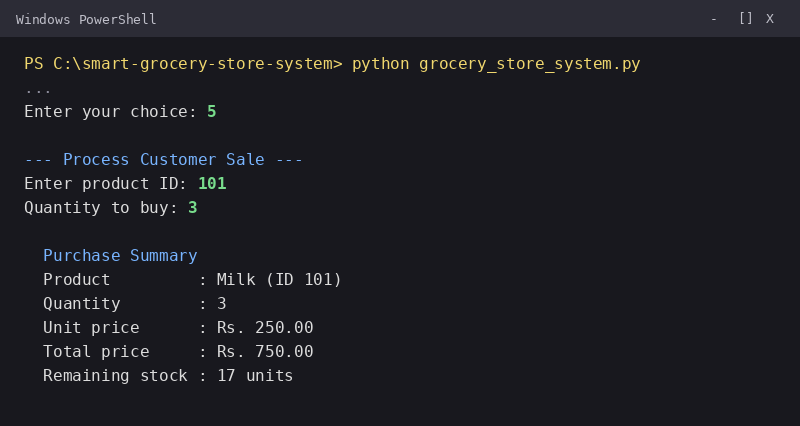

**Store report after two sales:**


---

## 8. Python Concepts Used

| Concept | Where it is used |
|---|---|
| Lists of dictionaries | `products` and `sales` |
| Dictionary keys and values | `product["stock"]`, `sale["total_amount"]`, building a dictionary in `add_product()` and `process_sale()` |
| `.append()` | Adding a product and recording a sale |
| `for` loops | Showing products and sales, searching, counting stock and revenue |
| `enumerate()` | Numbering the rows in the sales table |
| `while True` loops and `break` | Main menu, input validation, duplicate-ID check |
| `if / elif / else` | Menu choice, stock checks, search type, update option |
| Functions (`def`, parameters, `return`) | 18 functions that receive the lists as arguments |
| `max()`, `min()`, `len()` | Report: highest and lowest price, counts |
| List comprehension / generator expressions | Highest and lowest priced product names |
| String methods | `.strip()`, `.lower()`, `.title()`, `.isdigit()`, `.join()`, slicing |
| f-strings with format specs | `{x:,.2f}`, `{x:<22}`, `{x:>12}` |
| Exception handling | `try / except ValueError`; `KeyboardInterrupt` and `EOFError` at startup |
| `math.isfinite()` | Rejecting `nan` and `inf` prices |

---

## 9. Test Cases

All tests were run on **Windows (PowerShell)** against the final code. Every expected result was checked automatically against the real program output. **Result: 40 of 40 passed.** In each screenshot, input you type is shown in **green** and error or warning messages in **red**. For long sessions the screenshot shows only the relevant part of the output; a grey `...` marks where earlier lines were left out. Every test starts from the six built-in sample products.

### 9.1 Summary

| ID | Scenario | Status |
|---|---|---|
| [G-01](#g-01-add-a-new-product) | Add a new product | ✅ Pass |
| [G-02](#g-02-duplicate-product-ids-are-blocked) | Duplicate product IDs are blocked | ✅ Pass |
| [G-03](#g-03-invalid-product-ids) | Invalid product IDs | ✅ Pass |
| [G-04](#g-04-empty-name-or-category) | Empty name or category | ✅ Pass |
| [G-05](#g-05-invalid-prices) | Invalid prices | ✅ Pass |
| [G-06](#g-06-invalid-stock-quantities) | Invalid stock quantities | ✅ Pass |
| [G-07](#g-07-zero-stock-allowed-category-cleaning) | Zero stock allowed; category cleaning | ✅ Pass |
| [G-08](#g-08-view-all-products) | View all products | ✅ Pass |
| [G-09](#g-09-search-by-id) | Search by ID | ✅ Pass |
| [G-10](#g-10-search-by-name-ignores-capitals) | Search by name ignores capitals | ✅ Pass |
| [G-11](#g-11-search-by-part-of-a-name) | Search by part of a name | ✅ Pass |
| [G-12](#g-12-search-with-several-matches) | Search with several matches | ✅ Pass |
| [G-13](#g-13-search-id-does-not-exist) | Search: ID does not exist | ✅ Pass |
| [G-14](#g-14-search-name-does-not-exist) | Search: name does not exist | ✅ Pass |
| [G-15](#g-15-search-with-empty-text) | Search with empty text | ✅ Pass |
| [G-16](#g-16-add-stock-to-a-product) | Add stock to a product | ✅ Pass |
| [G-17](#g-17-set-a-new-quantity) | Set a new quantity | ✅ Pass |
| [G-18](#g-18-set-quantity-to-zero) | Set quantity to zero | ✅ Pass |
| [G-19](#g-19-update-stock-unknown-id) | Update stock: unknown ID | ✅ Pass |
| [G-20](#g-20-invalid-amount-when-adding-stock) | Invalid amount when adding stock | ✅ Pass |
| [G-21](#g-21-invalid-update-option) | Invalid update option | ✅ Pass |
| [G-22](#g-22-invalid-new-quantity) | Invalid new quantity | ✅ Pass |
| [G-23](#g-23-successful-sale) | Successful sale | ✅ Pass |
| [G-24](#g-24-sale-refused-quantity-above-stock) | Sale refused: quantity above stock | ✅ Pass |
| [G-25](#g-25-sell-the-entire-stock) | Sell the entire stock | ✅ Pass |
| [G-26](#g-26-sale-unknown-product-id) | Sale: unknown product ID | ✅ Pass |
| [G-27](#g-27-invalid-purchase-quantities) | Invalid purchase quantities | ✅ Pass |
| [G-28](#g-28-sale-refused-product-out-of-stock) | Sale refused: product out of stock | ✅ Pass |
| [G-29](#g-29-sale-with-a-decimal-price) | Sale with a decimal price | ✅ Pass |
| [G-30](#g-30-sales-records-when-empty) | Sales records when empty | ✅ Pass |
| [G-31](#g-31-sales-records-after-three-sales) | Sales records after three sales | ✅ Pass |
| [G-32](#g-32-store-report-with-no-sales) | Store report with no sales | ✅ Pass |
| [G-33](#g-33-store-report-after-sales-and-a-restock) | Store report after sales and a restock | ✅ Pass |
| [G-34](#g-34-boundary-stock-of-exactly-5-is-not-low) | Boundary: stock of exactly 5 is not low | ✅ Pass |
| [G-35](#g-35-two-products-share-the-highest-price) | Two products share the highest price | ✅ Pass |
| [G-36](#g-36-invalid-menu-choices) | Invalid menu choices | ✅ Pass |
| [G-37](#g-37-exit-after-a-sale) | Exit after a sale | ✅ Pass |
| [G-38](#g-38-menu-choice-with-extra-spaces) | Menu choice with extra spaces | ✅ Pass |
| [G-39](#g-39-exit-immediately) | Exit immediately | ✅ Pass |
| [G-40](#g-40-long-product-name-is-shortened-in-the-table) | Long product name is shortened in the table | ✅ Pass |

### 9.2 Test details

#### G-01: Add a new product

| | |
|---|---|
| **Input** | ID `107`, name `Almond Milk`, category `dairy`, price `450`, stock `10`, then view all |
| **Expected** | Product added and visible in the table, category in Title Case |
| **Actual** | Matches expected |
| **Status** | ✅ Pass |

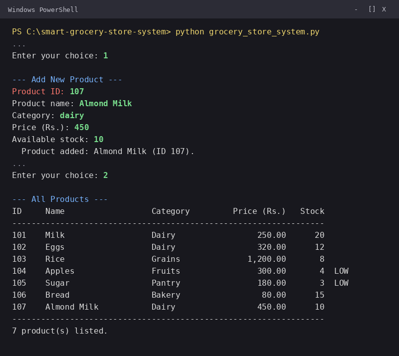


#### G-02: Duplicate product IDs are blocked

| | |
|---|---|
| **Input** | IDs `101` and `106` (already used), then `107` |
| **Expected** | Both duplicates rejected with the existing product's name; `107` accepted |
| **Actual** | Matches expected |
| **Status** | ✅ Pass |

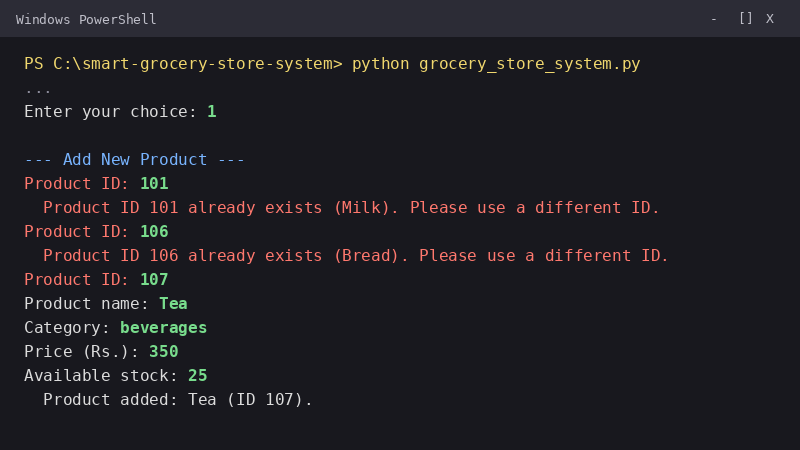


#### G-03: Invalid product IDs

| | |
|---|---|
| **Input** | IDs `0`, `abc`, `2.5`, `-4`, then `107` |
| **Expected** | `0` and `-4` rejected as below 1; `abc` and `2.5` rejected as non-whole |
| **Actual** | Matches expected |
| **Status** | ✅ Pass |

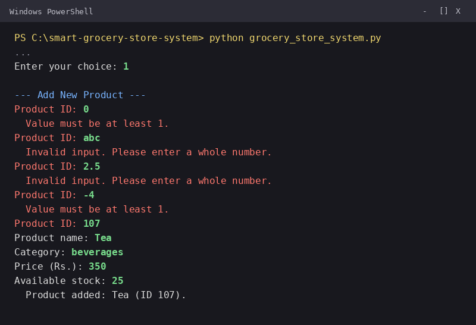


#### G-04: Empty name or category

| | |
|---|---|
| **Input** | Name `   `, then `Tea`; category `  `, then `beverages` |
| **Expected** | Both empty values rejected and asked again |
| **Actual** | Matches expected |
| **Status** | ✅ Pass |

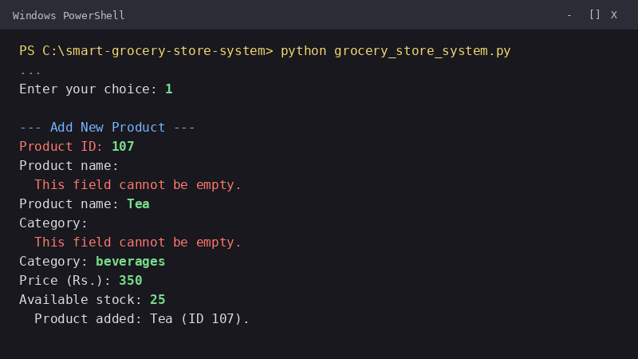


#### G-05: Invalid prices

| | |
|---|---|
| **Input** | Price `0`, `-5`, `abc`, `inf`, then `350` |
| **Expected** | `0` and `-5` rejected as not above zero; `abc` and `inf` rejected as non-numbers |
| **Actual** | Matches expected |
| **Status** | ✅ Pass |

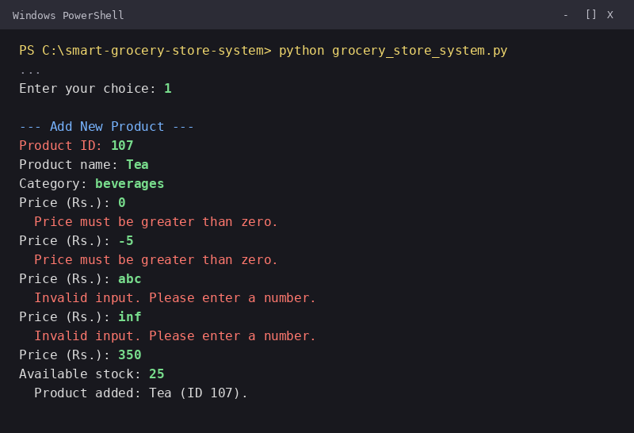


#### G-06: Invalid stock quantities

| | |
|---|---|
| **Input** | Stock `-1`, `abc`, `2.5`, then `25` |
| **Expected** | Negative and non-whole values rejected |
| **Actual** | Matches expected |
| **Status** | ✅ Pass |

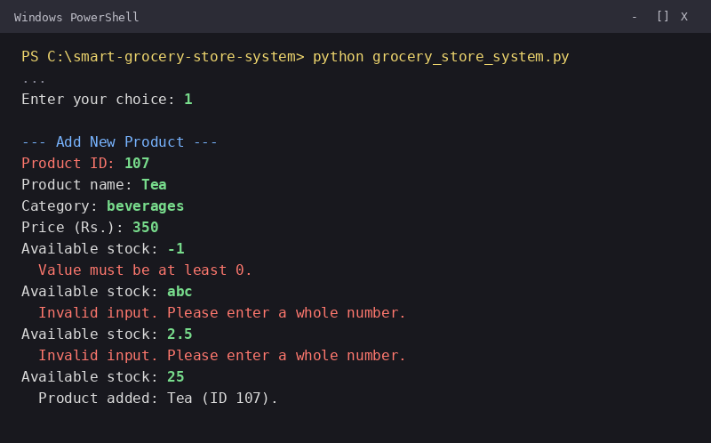


#### G-07: Zero stock allowed; category cleaning

| | |
|---|---|
| **Input** | Category `  hOT drinks `, stock `0` |
| **Expected** | Category stored as `Hot Drinks`; product flagged LOW |
| **Actual** | Matches expected |
| **Status** | ✅ Pass |

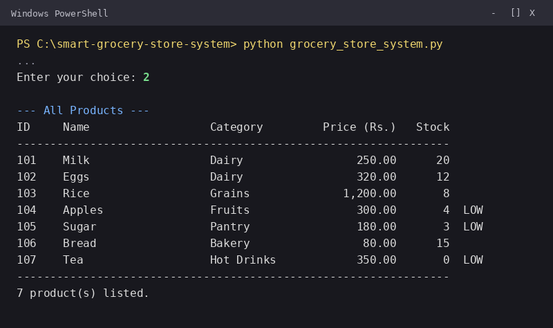


#### G-08: View all products

| | |
|---|---|
| **Input** | Menu `2` |
| **Expected** | Table of all 6 starting products; Apples and Sugar flagged LOW |
| **Actual** | Matches expected |
| **Status** | ✅ Pass |


#### G-09: Search by ID

| | |
|---|---|
| **Input** | Search `103` |
| **Expected** | Complete details of Rice |
| **Actual** | Matches expected |
| **Status** | ✅ Pass |

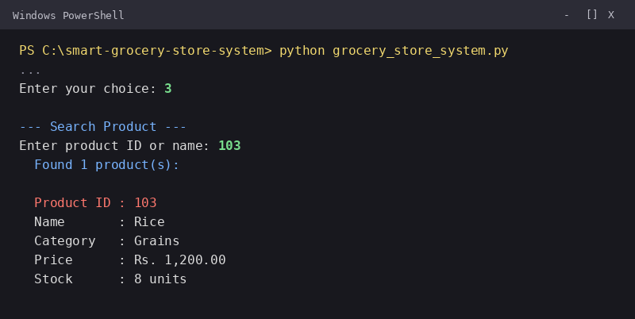


#### G-10: Search by name ignores capitals

| | |
|---|---|
| **Input** | Search `mIlK` |
| **Expected** | Milk found |
| **Actual** | Matches expected |
| **Status** | ✅ Pass |

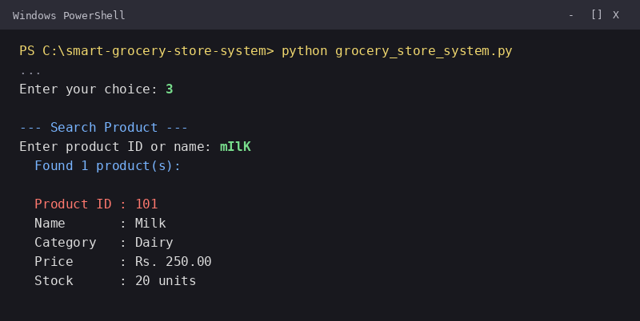


#### G-11: Search by part of a name

| | |
|---|---|
| **Input** | Search `ap` |
| **Expected** | Apples found |
| **Actual** | Matches expected |
| **Status** | ✅ Pass |

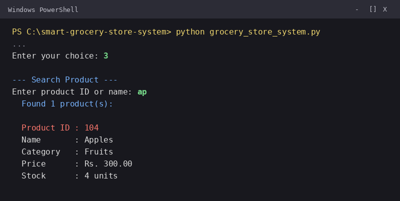


#### G-12: Search with several matches

| | |
|---|---|
| **Input** | Add `Almond Milk`, then search `milk` |
| **Expected** | Both Milk and Almond Milk shown |
| **Actual** | Matches expected |
| **Status** | ✅ Pass |

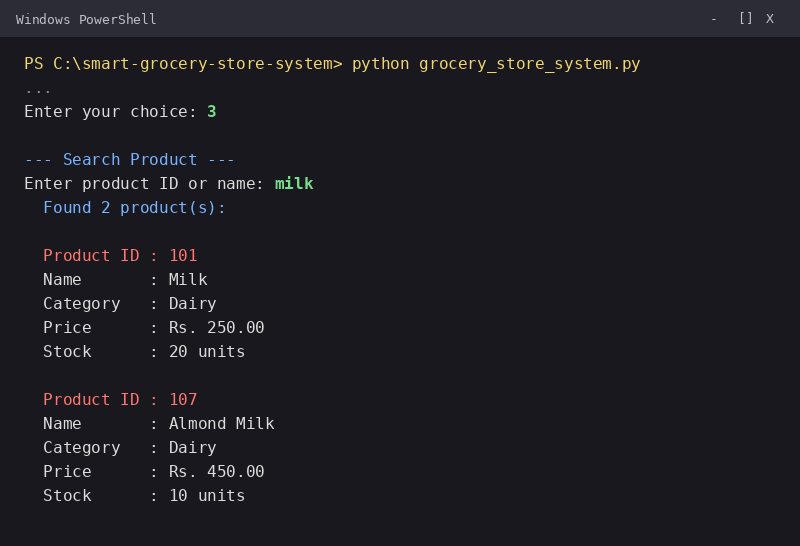


#### G-13: Search: ID does not exist

| | |
|---|---|
| **Input** | Search `999` |
| **Expected** | Clear 'not found' message |
| **Actual** | Matches expected |
| **Status** | ✅ Pass |

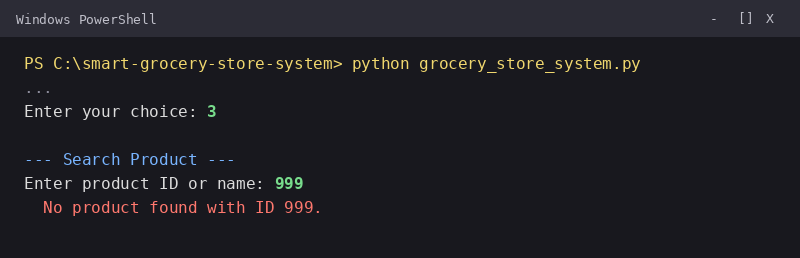


#### G-14: Search: name does not exist

| | |
|---|---|
| **Input** | Search `chocolate` |
| **Expected** | Clear 'not found' message |
| **Actual** | Matches expected |
| **Status** | ✅ Pass |

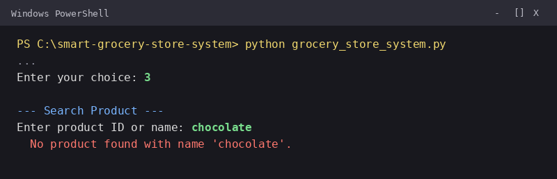


#### G-15: Search with empty text

| | |
|---|---|
| **Input** | Search `   ` (spaces only) |
| **Expected** | Rejected with a message |
| **Actual** | Matches expected |
| **Status** | ✅ Pass |

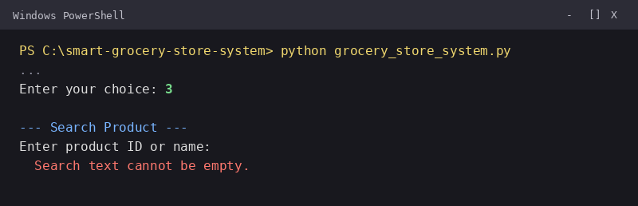


#### G-16: Add stock to a product

| | |
|---|---|
| **Input** | ID `101`, option `1` (add), `15` units, then view |
| **Expected** | Milk goes from 20 to 35 units |
| **Actual** | Matches expected |
| **Status** | ✅ Pass |

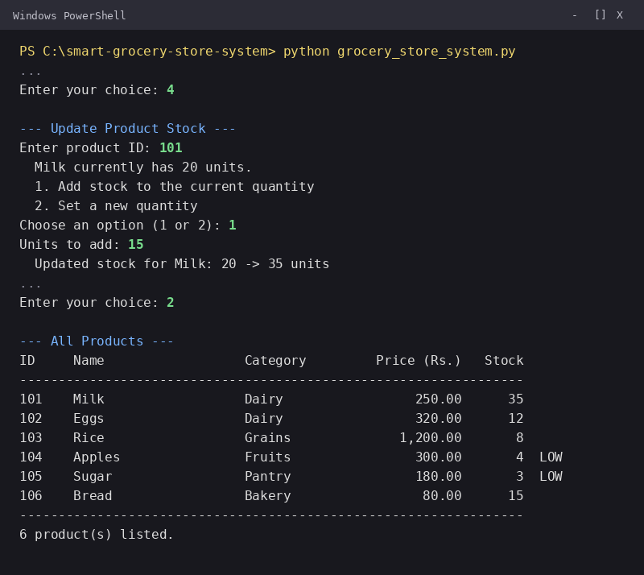


#### G-17: Set a new quantity

| | |
|---|---|
| **Input** | ID `103`, option `2` (set), `50` |
| **Expected** | Rice goes from 8 to 50 units |
| **Actual** | Matches expected |
| **Status** | ✅ Pass |

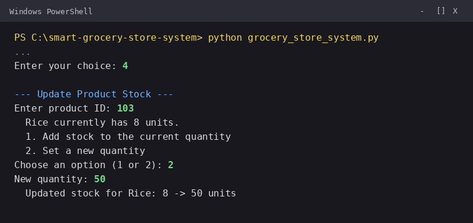


#### G-18: Set quantity to zero

| | |
|---|---|
| **Input** | ID `106`, option `2`, `0` |
| **Expected** | Zero is allowed: Bread goes from 15 to 0 |
| **Actual** | Matches expected |
| **Status** | ✅ Pass |

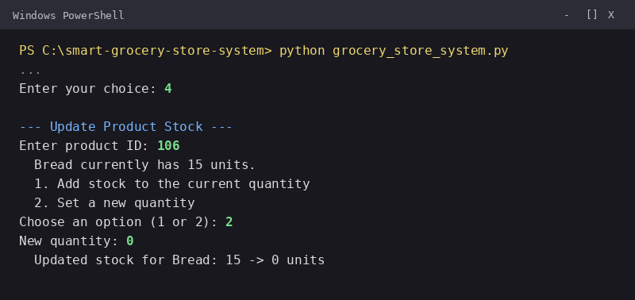


#### G-19: Update stock: unknown ID

| | |
|---|---|
| **Input** | ID `999` |
| **Expected** | Clear 'not found' message |
| **Actual** | Matches expected |
| **Status** | ✅ Pass |

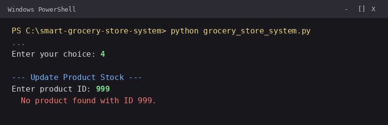


#### G-20: Invalid amount when adding stock

| | |
|---|---|
| **Input** | Units to add `0`, `-3`, `abc`, then `5` |
| **Expected** | `0` and `-3` rejected as below 1; `abc` rejected; `5` accepted |
| **Actual** | Matches expected |
| **Status** | ✅ Pass |

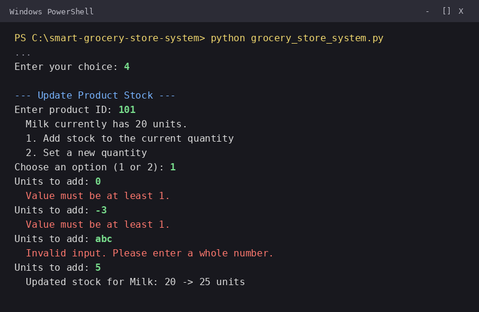


#### G-21: Invalid update option

| | |
|---|---|
| **Input** | Option `3`, `abc`, empty, then `1` |
| **Expected** | Three invalid options rejected, `1` accepted |
| **Actual** | Matches expected |
| **Status** | ✅ Pass |

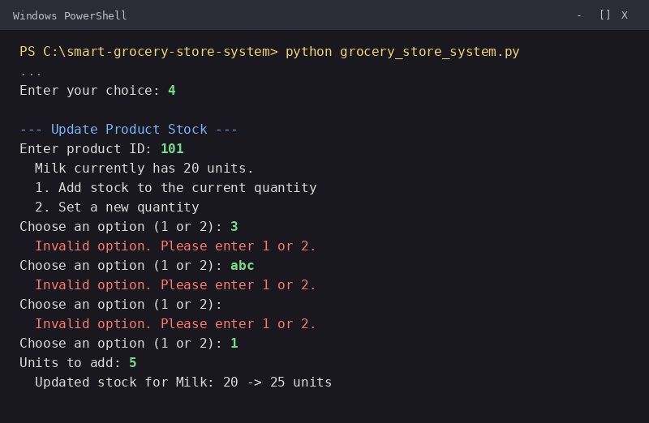


#### G-22: Invalid new quantity

| | |
|---|---|
| **Input** | New quantity `-5`, `abc`, then `30` |
| **Expected** | Negative and text rejected, `30` accepted |
| **Actual** | Matches expected |
| **Status** | ✅ Pass |

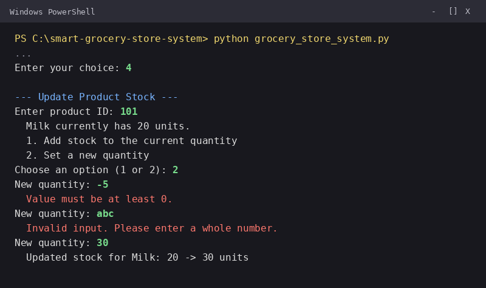


#### G-23: Successful sale

| | |
|---|---|
| **Input** | ID `101`, quantity `3`, then view all |
| **Expected** | Summary shows total 750.00; stock drops from 20 to 17 |
| **Actual** | Matches expected |
| **Status** | ✅ Pass |

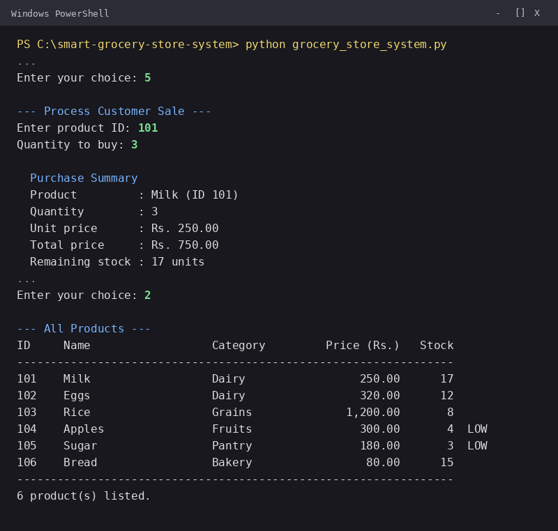


#### G-24: Sale refused: quantity above stock

| | |
|---|---|
| **Input** | Apples (stock 4), quantity `10` |
| **Expected** | Sale cancelled with the available stock shown; stock stays 4 |
| **Actual** | Matches expected |
| **Status** | ✅ Pass |

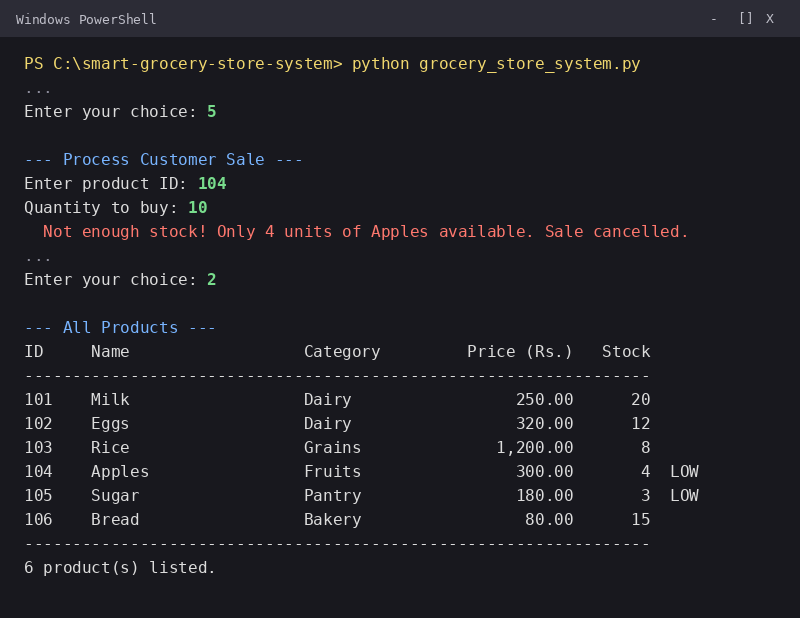


#### G-25: Sell the entire stock

| | |
|---|---|
| **Input** | Sugar (stock 3), quantity `3` |
| **Expected** | Total 540.00; stock becomes 0 |
| **Actual** | Matches expected |
| **Status** | ✅ Pass |


#### G-26: Sale: unknown product ID

| | |
|---|---|
| **Input** | ID `999` |
| **Expected** | Sale cancelled with a message |
| **Actual** | Matches expected |
| **Status** | ✅ Pass |

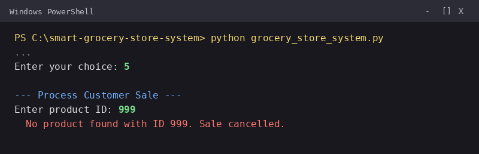


#### G-27: Invalid purchase quantities

| | |
|---|---|
| **Input** | Quantity `0`, `-2`, `abc`, `2.5`, then `4` |
| **Expected** | `0` and `-2` rejected as below 1; `abc` and `2.5` rejected; `4` accepted |
| **Actual** | Matches expected |
| **Status** | ✅ Pass |

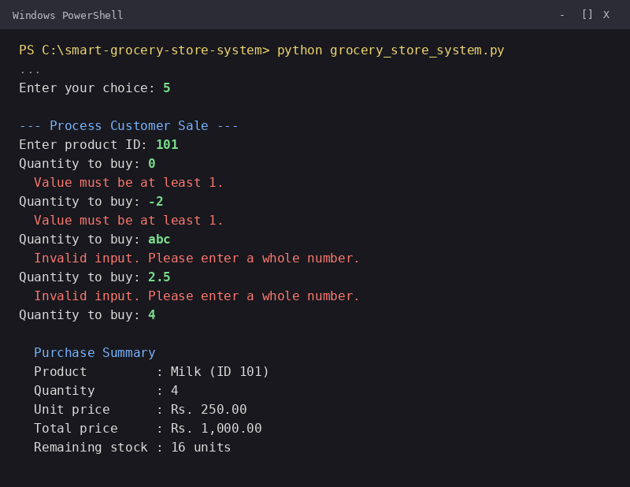


#### G-28: Sale refused: product out of stock

| | |
|---|---|
| **Input** | Set Bread to `0`, then try to sell Bread |
| **Expected** | Sale cancelled: out of stock |
| **Actual** | Matches expected |
| **Status** | ✅ Pass |

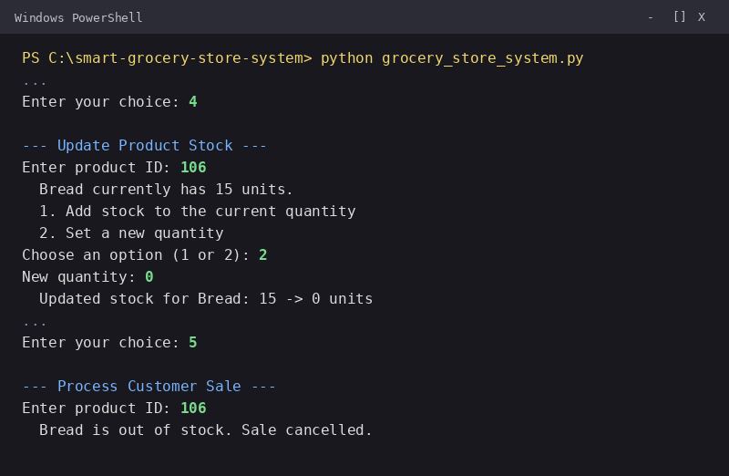


#### G-29: Sale with a decimal price

| | |
|---|---|
| **Input** | Add Loose Tea (Rs. 12.5, stock 40), sell `3` |
| **Expected** | Total 37.50; stock drops to 37 |
| **Actual** | Matches expected |
| **Status** | ✅ Pass |

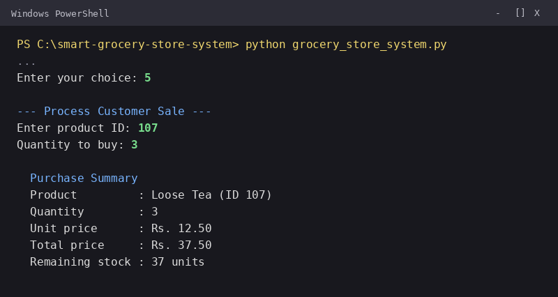


#### G-30: Sales records when empty

| | |
|---|---|
| **Input** | Menu `6` before any sale |
| **Expected** | Friendly message |
| **Actual** | Matches expected |
| **Status** | ✅ Pass |

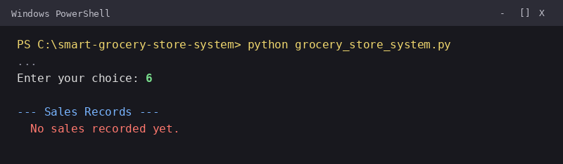


#### G-31: Sales records after three sales

| | |
|---|---|
| **Input** | Sell Milk x3, Bread x5, Rice x1, then menu `6` |
| **Expected** | Three records with total revenue 2,350.00 |
| **Actual** | Matches expected |
| **Status** | ✅ Pass |

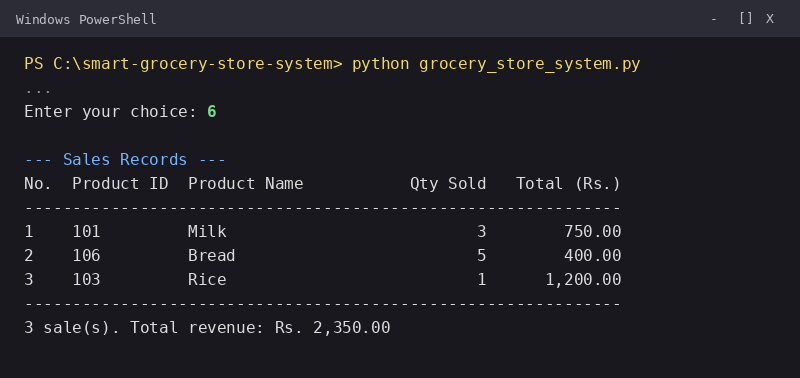


#### G-32: Store report with no sales

| | |
|---|---|
| **Input** | Menu `7` on a fresh store |
| **Expected** | 6 products, 62 units, 0 transactions, revenue 0.00, two low-stock products, highest Rice, lowest Bread |
| **Actual** | Matches expected |
| **Status** | ✅ Pass |

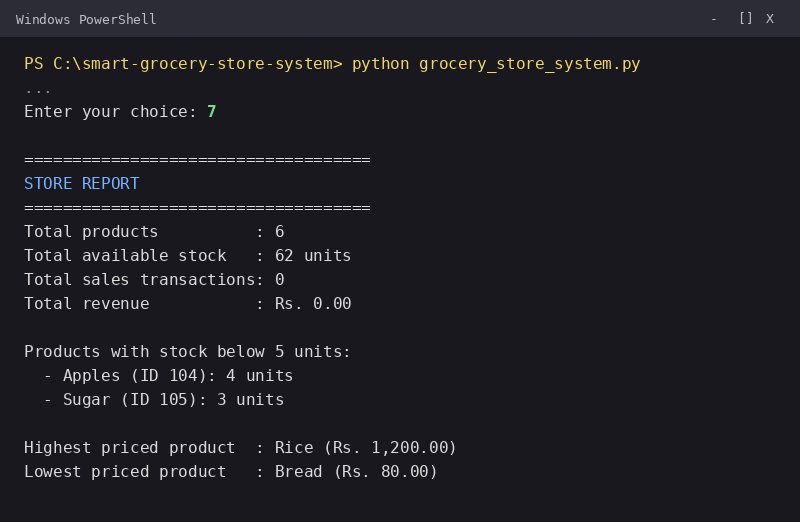


#### G-33: Store report after sales and a restock

| | |
|---|---|
| **Input** | Sell Milk x3 and Bread x5; add `10` units to Sugar; menu `7` |
| **Expected** | 2 transactions, revenue 1,150.00, total stock 64; only Apples is still low |
| **Actual** | Matches expected |
| **Status** | ✅ Pass |

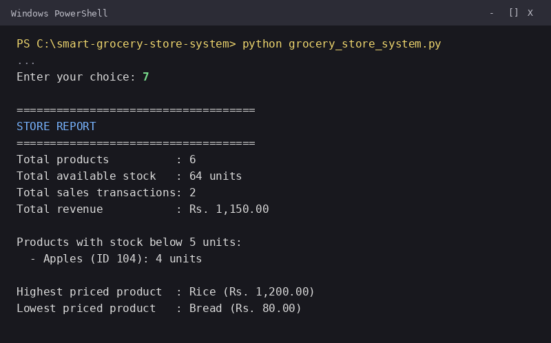


#### G-34: Boundary: stock of exactly 5 is not low

| | |
|---|---|
| **Input** | Set Apples to `5`, then menu `7` |
| **Expected** | Apples no longer listed (low means below 5); Sugar (3) still is |
| **Actual** | Matches expected |
| **Status** | ✅ Pass |

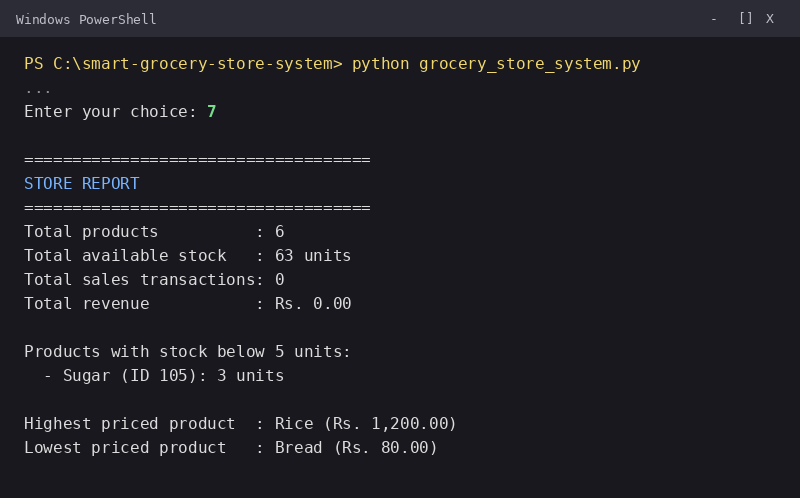


#### G-35: Two products share the highest price

| | |
|---|---|
| **Input** | Add Wheat Flour at Rs. 1,200, then menu `7` |
| **Expected** | Both listed as highest priced |
| **Actual** | Matches expected |
| **Status** | ✅ Pass |

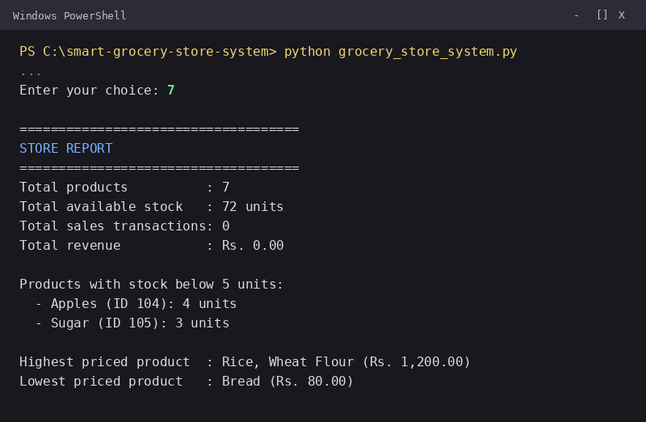


#### G-36: Invalid menu choices

| | |
|---|---|
| **Input** | `0`, `9`, `abc`, empty, `2.5`, `-1`, then `8` |
| **Expected** | All six rejected; `8` exits |
| **Actual** | Matches expected |
| **Status** | ✅ Pass |

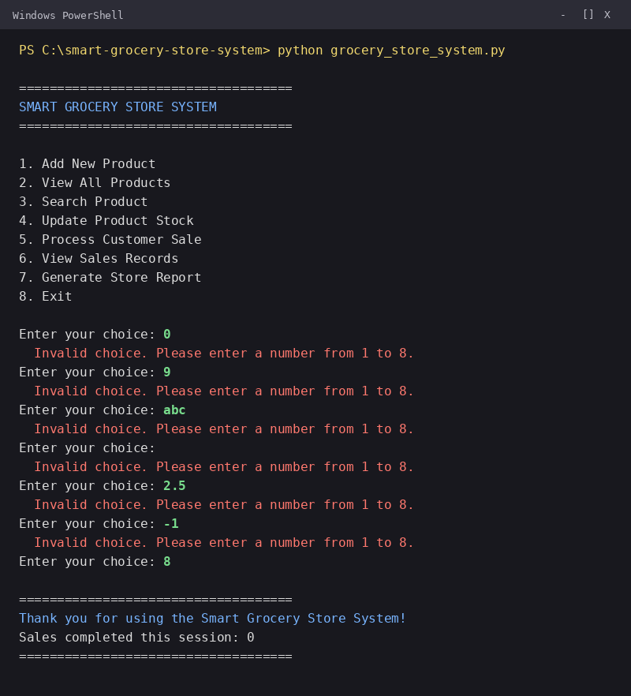


#### G-37: Exit after a sale

| | |
|---|---|
| **Input** | Sell Milk x2, then menu `8` |
| **Expected** | Goodbye message counts 1 sale |
| **Actual** | Matches expected |
| **Status** | ✅ Pass |

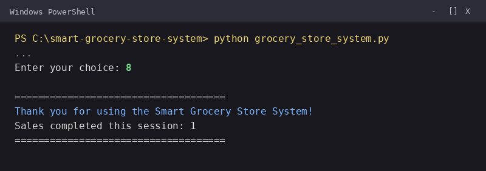


#### G-38: Menu choice with extra spaces

| | |
|---|---|
| **Input** | Menu choice ` 2 ` |
| **Expected** | Trimmed and accepted as `2` |
| **Actual** | Matches expected |
| **Status** | ✅ Pass |

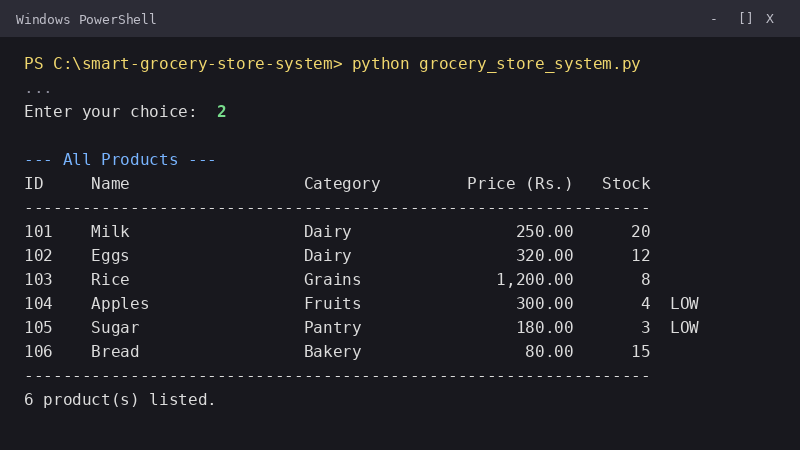


#### G-39: Exit immediately

| | |
|---|---|
| **Input** | Menu `8` straight away |
| **Expected** | Goodbye message counts 0 sales |
| **Actual** | Matches expected |
| **Status** | ✅ Pass |

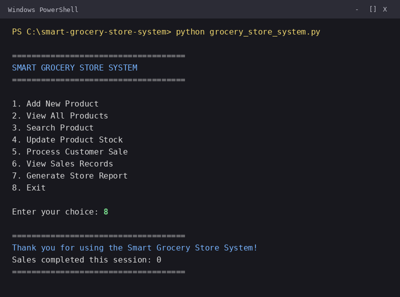


#### G-40: Long product name is shortened in the table

| | |
|---|---|
| **Input** | Product name of 41 characters |
| **Expected** | Shown as `Premium Basmati R...` so columns stay aligned |
| **Actual** | Matches expected |
| **Status** | ✅ Pass |

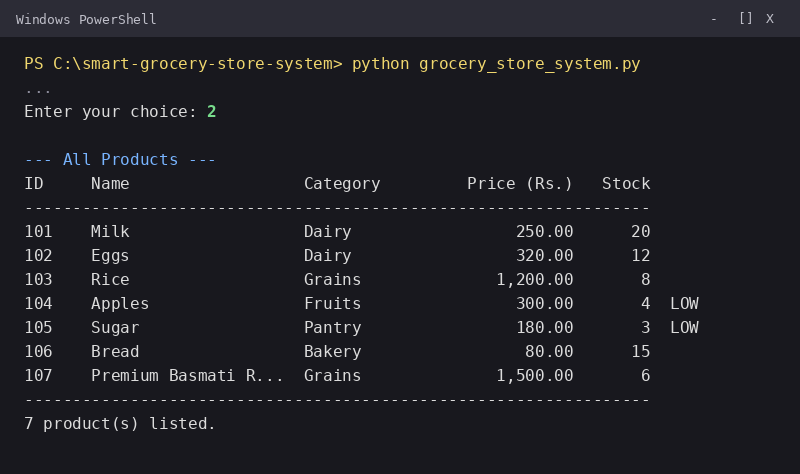


### 9.3 How to reproduce a test on Windows

**Easiest way:** run `python grocery_store_system.py` in PowerShell and type the inputs shown in each test.

**Faster way (pipe the inputs).** In **PowerShell**, `` `n `` means "press Enter":

```powershell
# Sell 3 units of Milk (ID 101), then view the sales records, then exit
"5`n101`n3`n6`n8" | python grocery_store_system.py
```

In **Command Prompt (cmd)**, put `&` directly after each value (no spaces):

```bat
(echo 5&echo 101&echo 3&echo 6&echo 8) | python grocery_store_system.py
```

---

## 10. Design Decisions

| Decision | Reason |
|---|---|
| **Starting sample products** | The owner can try every feature straight away, and low-stock features can be demonstrated. |
| **Duplicate-ID check in a loop** | The user keeps entering IDs until one is free, so a duplicate never reaches the list. |
| **Search by digits means ID, otherwise name** | One search box works for both, as the task asks. |
| **Name search is partial and case-insensitive** | `milk` finds both `Milk` and `Almond Milk`; this is friendlier than exact matching. |
| **Sale checks in a fixed order** | Product exists, then stock above zero, then quantity within stock. The first failed check cancels the sale and nothing is changed or recorded. |
| **Sales are saved in their own dictionaries** | The product's price may change later, but each sale keeps the amount that was actually charged. |
| **Stock of `0` is allowed; price must be above 0** | A product can be listed while out of stock, but a free product makes no sense. |
| **Low stock means below 5** | Exactly 5 units is not low (test G-34 proves the boundary). |
| **Ties for highest or lowest price are all listed** | Showing only one product would hide the others. |
| **`math.isfinite()` on prices** | `float("inf")` and `float("nan")` succeed in Python and would otherwise be accepted. |
| **Category stored in Title Case, name kept as typed** | Categories stay consistent; changing the case of a name could damage words such as "iPhone". |

---

## 11. Known Limitations & Future Improvements

**Current limitations**
- Data is kept only in memory; products and sales are lost when the program closes.
- A customer buys one product per sale (no shopping cart).
- Sales have no date or time.
- There is no way to edit a product's name or price, or to delete a product.
- Prices are in rupees (Rs.) only; there is no tax or discount.

**Possible improvements**
- Save and load products and sales with a JSON or CSV file.
- Add a shopping cart so one customer can buy several products at once.
- Store the date and time of each sale and add a daily report.
- Add "edit product" and "delete product" options.
- Add automated tests with `unittest` or `pytest`, reusing the cases in section 9.

---

*Built as the "Smart Grocery Store Management System" project.*
